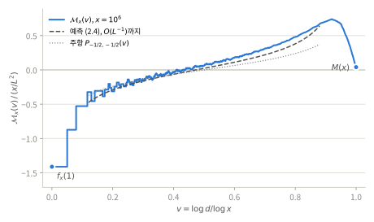

# 약수별 누적합으로 얻는 M(x)

각 $n$의 $\mu(n)$을 약수에 똑같이 나눠 준 뒤 약수 $d$별로 모으고, $d$ 순서로 다시 더하면 Mertens 함수 $M(x)=\sum_{n\le x}\mu(n)$이 정확히 나온다. 이 문서는 그 항등식과, 누적 곡선의 모양이 베타핵 $\mathcal K_{-1/2,-1/2}$를 따른다는 점을 정리한다. 절·명제·수식 번호는 이 문서 안에서 독립적이다.

기호는 [주정리](main-theorem.md)를 따른다. $\nu_n$은 DDT의 균등 약수측도([주정리 §1](main-theorem.md#section-1)), $\mathcal K_{z,w}$는 베타핵([주정리 §4](main-theorem.md#section-4)), $L=\log x$, $\gamma_E$는 오일러 상수이다.

| 결과 | 내용 | 범위 |
|:--|:--|:--|
| [명제 1.1](#section-1) | 약수별 몫의 합은 $M(x)$, 몫의 분해식 | 정확한 항등식 |
| [명제 2.1](#section-2) | 매끄러운 시험함수에 대한 1차 법칙 | 주정리 보조정리 1의 따름정리 |
| [(2.4)](#equation-2-4) | 누적 곡선의 닫힌 꼴 예측 | **[휴리스틱]**, 수치 |

- [§1. 약수별 몫과 M(x)](#section-1)
- [§2. 누적 곡선과 베타핵](#section-2)
- [§3. 계산 절차](#section-3)
- [검산](#checks)

## 1. 약수별 몫과 M(x)

$$
f_x(d)=\sum_{\substack{n\le x\\ d\mid n}}\frac{\mu(n)}{\tau(n)},
\qquad
\mathcal M_x(v)=\sum_{d\le x^v}f_x(d)\quad(0\le v\le1)
\tag{1.1}
$$

로 둔다. $f_x(d)$는 각 $n\le x$의 $\mu(n)$을 약수 $\tau(n)$개에 똑같이 나눌 때 $d$가 받는 몫의 합이다. 즉 $\sum_{n\le x}\mu(n)\nu_n$과 같은 가중치를 쓰되, 약수의 위치를 $\log d/\log n$이 아니라 $d$ 자체로 기록한다.

**명제 1.1.** 모든 $x\ge1$에서

$$
\mathcal M_x(1)=\sum_{d\le x}f_x(d)=M(x),
\tag{1.2}
$$

$$
\sum_{d\le x}f_x(d)\log d=\frac12\sum_{n\le x}\mu(n)\log n,
\tag{1.3}
$$

$$
f_x(d)=\frac{\mu(d)}{\tau(d)}\sum_{\substack{m\le x/d\\(m,d)=1}}\frac{\mu(m)}{\tau(m)}
\tag{1.4}
$$

이다.

**증명.** 합의 순서를 바꾸면 $\sum_df_x(d)=\sum_{n\le x}\mu(n)\tau(n)^{-1}\sum_{d\mid n}1=M(x)$이다. $\sum_{d\mid n}\log d=\tfrac12\tau(n)\log n$에서 (1.3)이 따른다. $\mu(n)\ne0$이고 $n=dm$이면 $(d,m)=1$이며, $\mu$와 $\tau$는 서로소인 곱에서 곱셈적이므로 (1.4)를 얻는다. $\square$

(1.4)에서 다음을 바로 읽을 수 있다.

- $\mu(d)=0$이면 $f_x(d)=0$이다.
- $x/2<d\le x$이면 $m=1$만 남아 $f_x(d)=\mu(d)/\tau(d)$이다.
- $f_x(1)=\sum_{m\le x}\mu^2(m)(-\tfrac12)^{\omega(m)}$이다. [주정리 정리 1](main-theorem.md#section-2)을 $(z,w)=(-\tfrac12,0)$, $F=1$에 적용하면

$$
f_x(1)=\frac{C(-\tfrac12)}{\Gamma(-\tfrac12)}\,\frac x{L^{3/2}}\bigl(1+O(L^{-1})\bigr),
\qquad \frac{C(-\tfrac12)}{\Gamma(-\tfrac12)}=-0.3095\ldots
\tag{1.5}
$$

이다. $x/d$가 크면 (1.4)의 안쪽 합도 같은 이유로 음수이다. 서로소 조건은 양의 국소 인수 $\prod_{p\mid d}(1-\tfrac1{2p})^{-1}$만 곱한다. 따라서 작은 $d$에서 $f_x(d)$의 부호는 $-\mu(d)$이고, $x/2<d$에서는 $\mu(d)$로 뒤집힌다.

**좌표.** 같은 $d$를 서로 다른 $n$에서 모았으므로 위치는 $u=\log d/L$이다. 제곱 인수 없는 $n$에서 $\mu(n)/\tau(n)=(-\tfrac12)^{\omega(n)}$이므로

$$
\sum_{d\le x}f_x(d)\,e^{i\xi\log d/L}=S_x(\xi)\Big|_{z=w=-1/2},
\qquad M(x)=S_x(0)
\tag{1.6}
$$

이다. $S_x$는 [주정리 (5.1)](main-theorem.md#equation-5-1)의 지수합이다. 따라서 이 모형은 [주정리 §2](main-theorem.md#section-2)의 제곱 인수 없는 모형이며, 제곱 인수가 있는 $n$에도 원자를 두는 [주정리 §8](main-theorem.md#section-8)의 $d_z$ 모형과는 다르다. 같은 가중치를 $\log d/\log n$ 좌표에서 본 것은 [뫼비우스 경우 §4](mobius-cases.md#section-4)이다.

## 2. 누적 곡선과 베타핵

$z=w=-\tfrac12$에서는 $C(-1)=1$, $\eta(-1)=0$이므로 [주정리 (6.1)](main-theorem.md#equation-6-1)의 계수는

$$
G_1=-\frac{\gamma_E}2,\qquad G_2=-\frac{\gamma_E}2-1
\tag{2.1}
$$

이다.

**명제 2.1.** 충분히 큰 유한 $N$과 $F\in C^N([0,1])$에 대해

$$
\sum_{d\le x}f_x(d)\,F\!\left(\frac{\log d}L\right)
=\frac x{L^2}\Big\langle\mathcal K_{-\frac12,-\frac12}+\frac1L\big(G_1\mathcal K_{-\frac32,-\frac12}+G_2\mathcal K_{-\frac12,-\frac32}\big),F\Big\rangle
+O_F\!\left(\frac x{L^4}\right).
\tag{2.2}
$$

**증명.** (1.6)에 [주정리 보조정리 1](main-theorem.md#section-6-1)을 $j=0$으로 적용하고 [주정리 §6.3](main-theorem.md#section-6-3)의 푸리에 적분을 그대로 쓴다. 좌표가 이미 $\log d/L$이므로 [주정리 §6.2](main-theorem.md#section-6-2)의 변수 변경은 필요 없다. $\square$

[주정리 (4.2)](main-theorem.md#equation-4-2)로 모멘트를 계산하면 $F=1,u$에서 주항과 보정항이 모두 $0$이며, 이는 (1.2)–(1.3)과 양립한다. $F=u^2$이면 $\langle\cdot,F\rangle=-\tfrac14$이고 보정항은 $0$이다. $F=u^3$이면 $-\tfrac38+\tfrac3{8L}$이다.

**누적 곡선.** $0<v<1$에서 $P_{z,w}(v):=\langle\mathbf 1_{(-\infty,v]}\mathcal K_{z,w},\chi\rangle=1/\Gamma(z+w)-T_{z,w}(v)$라 하자. $\chi$와 $T$는 [주정리 (7.5)](main-theorem.md#equation-7-5)와 같다. 불완전 베타적분을 $z$에 대해 연장하면

$$
P_{z,w}(v)=\frac{v^z\,{}_2F_1(z,1-w;z+1;v)}{\Gamma(z+1)\,\Gamma(w)}
\tag{2.3}
$$

이다. (2.2)에 $F=\mathbf 1_{[0,v]}$를 형식적으로 넣고, $P_{-3/2,-1/2}-P_{-1/2,-3/2}=\mathcal K_{-1/2,-1/2}(v)$([주정리 (4.3)](main-theorem.md#equation-4-3))와 ${}_2F_1(-\tfrac12,\tfrac52;\tfrac12;v)=(1-v)^{-3/2}(1-4v+\tfrac83v^2)$를 쓰면 다음을 얻는다.

$$
\frac{\mathcal M_x(v)}{x/L^2}\approx
\frac{v-\frac12}{\pi\sqrt{v(1-v)}}
-\frac{\frac{\gamma_E}2+(\gamma_E+1)(3v-12v^2+8v^3)}{4\pi L\,[v(1-v)]^{3/2}}.
\tag{2.4}
$$

첫 항은 $-T_{-1/2,-1/2}(v)$이다. **[휴리스틱]** 지시함수는 매끄럽지 않으므로 (2.4)는 명제 2.1에서 따르지 않는다. [주정리 §7](main-theorem.md#section-7)의 꼬리값에 대한 주의와 같다.

**누적 곡선 읽기.** 주항의 총질량은 $0$이고, 끝점 근처에서는 $v\to0$일 때 $-\infty$, $v\to1$일 때 $+\infty$로 간다. 실제 곡선은 $v=0$에서 $f_x(1)$로 시작한다. 안쪽에서는 양의 밀도 $\mathcal K_{-1/2,-1/2}(v)=1/(4\pi[v(1-v)]^{3/2})$를 따라 오르고, 마지막 구간 $x/2<d\le x$에서 $\sum\mu(d)/\tau(d)$만큼 떨어져 $M(x)$에 닿는다. 양 끝의 질량은 (1.5)처럼 $x/L^{3/2}$ 규모이고 서로 거의 상쇄된다. $M(x)$는 그 나머지이다. 끝점에서 $1/L$ 이내로 들어가면 (2.4)의 두 항이 같은 크기가 되어 전개가 무너진다.

**수치.** $f_x(1)$ 열과 $v$ 열은 $\mathcal M_x(v)$를 $x/L^2$로 나눈 실측값이고, 괄호 안은 (2.4)의 주항과 $O(L^{-1})$까지의 값이다. $M(x)$ 열은 나누지 않은 값이다.

| $x$ | $f_x(1)$ | $v=0.2$ | $v=0.5$ | $v=0.8$ | $M(x)$ |
|:--|--:|--:|--:|--:|--:|
| $10^4$ | −1.378 | −0.398 (−0.239, −0.317) | −0.053 (0, +0.035) | +0.367 (+0.239, +0.452) | −23 |
| $10^5$ | −1.385 | −0.364 (−0.239, −0.301) | +0.034 (0, +0.028) | +0.434 (+0.239, +0.409) | −48 |
| $10^6$ | −1.412 | −0.312 (−0.239, −0.291) | +0.062 (0, +0.023) | +0.480 (+0.239, +0.381) | 212 |

$O(L^{-1})$ 항을 더하면 안쪽에서 주항보다 잘 맞지만, $x\le10^6$에서 남은 차이는 $x/L^4$ 규모보다 크다. 매끄러운 $F=u^2,u^3$에서도 $(\text{실측}-\text{예측})L^2$이 $10^4,10^5,10^6$에서 각각 $-6.3,-3.4,+2.9$와 $-5.6,-3.1,+2.5$로 안정되지 않는다. 부호는 $M(x)$와 함께 바뀐다. 고정 차수 전개 밖의 진동 항이 이 범위에서는 아직 크다는 뜻으로 읽힌다.

## 3. 계산 절차

1. 체로 $n\le x$의 $\mu(n)$과 $\omega(n)$을 구하고 $w(n)=\mu(n)2^{-\omega(n)}=\mu(n)/\tau(n)$으로 둔다.
2. 각 $d\le x$에서 $f_x(d)=\sum_{k\le x/d}w(kd)$를 더한다. 덧셈은 모두 $\sum_{d\le x}x/d\approx xL$회이다. (1.4)를 쓰면 $\mu(d)\ne0$인 $d$만 계산하면 된다.
3. $d$ 순서로 누적해 $\mathcal M_x(v)$를 얻는다. 마지막 값이 $M(x)$이다.

모든 몫은 $\pm2^{-k}$의 합이므로 $x\le10^6$에서는 배정밀도 덧셈도 정확하다. 이 절차는 $M(x)$를 직접 더하는 것보다 빠르지 않다. 쓸모는 $M(x)$가 약수 위치별로 어떻게 다시 조립되는지 보여 주는 데 있다.

## 검산

[검산 스크립트](../scripts/check_divisor_cumsum.py)는 numpy와 scipy를 사용하며 다음을 확인한다.

- (1.2): $x=10^4,10^5,10^6$에서 $\sum_df_x(d)=M(x)$가 정확히 성립한다($-23,-48,212$). (1.3)은 $10^{-11}$ 안에서 맞는다.
- (1.4): $x=10^4$의 모든 $d$에서 오차 없이 성립한다.
- (1.5): $f_x(1)L^{3/2}/x$는 $-0.454,-0.408,-0.380$이고, [주정리 (2.2)](main-theorem.md#equation-2-2)의 2항 근사 $-0.386,-0.371,-0.361$로 다가간다.
- (2.3)–(2.4): (2.3)은 양의 지수에서 정규화한 불완전 베타 함수와, $(-\tfrac12,\pm\tfrac12)$에서 [주정리 (7.5)](main-theorem.md#equation-7-5)의 꼬리값과 맞는다. (2.3)으로 계산한 (2.4)의 우변은 닫힌 꼴과 맞는다. 모두 $10^{-14}$ 안이다.
- [표](#table-2-1)와 $F=u^2,u^3$의 모멘트를 계산한다. `--figure`로 위 그림을 다시 만든다.

수치 확인은 증명을 대체하지 않는다.

    python -B scripts/check_divisor_cumsum.py
    python -B scripts/check_divisor_cumsum.py --figure docs/figures/divisor-cumsum.svg
