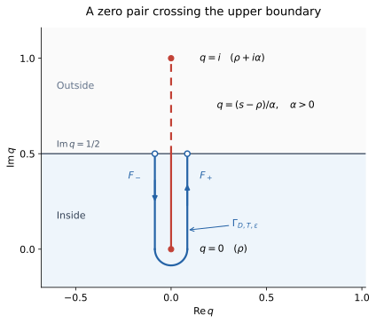

# 약수 구조를 통한 FTA의 영점 운송

**2026-11-03 (전역 공식·가우스 합산·산술 평활화 제거)**

여기서 FTA는 산술의 기본정리, 즉 소인수분해의 유일성이다. [주정리 문서 §8](main-theorem.md#section-8)의 이산핵을 소수별 유한 합성곱으로 쓰고, 그 생성함수를 Hadamard 영점 곱으로 옮긴 뒤 Perron 역변환으로 되돌린다.

고전적인 Euler 곱과 Hadamard 곱을 연결하여 **전체 이산핵 계열**을 영점 자료로 표현한다. 영점의 위치·중복도에 감마 인자와 정규화 상수를 함께 사용한다.

| 결과 | 조건과 의미 |
|:--|:--|
| [정리 1–2: 영점 곱과 재구성](#section-1-2) | 정규화된 전체 영점 자료로 정확히 복원; 유한 절단오차는 (1.9) |
| [§2.4: 평활화된 유한 공식](#section-2-4) | 유계한 $\xi$, 로그폭 평활화와 완전한 영점 쌍; 나머지 $O(x^{-1})$ |
| [정리 4: 원래 정수합의 유한 공식](#section-3-4) | 유계한 $\xi$, 반정수 중심, 영점 쪽 가우스 가중치와 경계 성분; 나머지 $O(x^{-1})$ |
| [정리 5: 정확한 가우스 합산](#section-3-5) | 고정된 비정수 $x>1$, 충분히 작은 $\lvert\alpha\rvert$; 지정한 동시 극한과 왼쪽 배경항 |

이 결과들은 RH나 단순영점 가정을 쓰지 않는다. $O(x^{-1})$는 극점·영점 성분을 정확한 윤곽 적분으로 유지한 공식의 나머지이다. §3은 산술합의 평활화를 제거하지만, 영점 쪽에는 가우스 합산 규칙이 남는다.

- [§1.1. 소수별 약수 선택과 FTA](#section-1-1)
- [§1.2. 정규화한 영점 곱](#section-1-2)
- [§1.3. 전역 재구성과 절단오차](#section-1-3)
- [§1.4. 유한 높이의 특이점별 분해](#section-1-4)
- [§1.5. 국소 베타핵과 전역 공식의 관계](#section-1-5)
- [§1.6. 약수 구조의 복원 범위](#section-1-6)
- [§2.1. 로그 변수의 가우스 평활화](#section-2-1)
- [§2.2. 두 제타 인자에 공통인 절단 높이](#section-2-2)
- [§2.3. 평활화된 유한 가법 공식](#section-2-3)
- [§2.4. 로그폭 선택과 작은 나머지](#section-2-4)
- [§2.5. 베타핵의 모양과 평활화 제거의 한계](#section-2-5)
- [§3.1. 반정수 절단점과 평활화 제거](#section-3-1)
- [§3.2. 경계에 걸리는 영점 성분](#section-3-2)
- [§3.3. 이동한 영점의 회피와 경계 공식](#section-3-3)
- [§3.4. 원래 정수합의 유한 공식](#section-3-4)
- [§3.5. 가우스 합산 극한과 이산핵 복원](#section-3-5)

**기호와 출발점.** 상승계승 $(z)_a=z(z+1)\cdots(z+a-1)$, $(z)_0=1$로부터 곱셈적 계수 $d_z(p^a)=(z)_a/a!$를 정의한다. $n\ge2$의 이산핵과 그 푸리에 변환을 모은 합은

$$
\mathscr K_n^{z,w}
=\sum_{d\mid n}d_z(d)d_w(n/d)\delta_{\log d/\log n},
\qquad
\mathfrak M_x(\xi)
=\sum_{dm\le x}d_{-1/2}(d)d_{-1/2}(m)e^{i\xi\log d/\log x}.
$$

$\delta_u$는 $u$에 놓인 단위 원자이고, $\mathfrak M_x$에는 $n=1$의 상수항 $1$이 포함된다. 그 변환 측도를 $\mathscr Q_x=\delta_0+\sum_{2\le n\le x}(T_{\log n/\log x})_*\mathscr K_n^{-1/2,-1/2}$로 쓴다. 여기서 $T_c(u)=cu$, 아래첨자 $*$는 측도의 밀어보내기이다. 기본 항등식은 $\sum d_z(n)n^{-s}=\zeta(s)^z$이며, 거듭제곱의 가지는 $\Re s>1$의 Euler 곱으로 정한다.

국소 근사에는 베타 분포핵 $\mathcal K_{a,b}(u)=g_a(u)g_b(1-u)$, $g_a(v)=v_+^{a-1}/\Gamma(a)$의 전체해석적 연장과 $\mathcal B_{a,b}(\xi)=\langle\mathcal K_{a,b},e^{i\xi u}\rangle$를 사용한다. 이산핵의 평균 점근식은 [주정리](main-theorem.md)에 있으며, 이 문서는 위의 정확한 변환에서 출발한다. $M(x)=\sum_{n\le x}\mu(n)$은 메르텐스 함수이다.

## 1. 전역 공식

### 1.1. 소수별 약수 선택과 FTA

$n=\prod_{p\mid n}p^{a_p}\ge2$라 하자. 각 소수 거듭제곱에 로그 약수의 유한 복소측도

$$
\lambda_{p,a}^{z,w}
=\sum_{j=0}^{a}
\frac{(z)_j(w)_{a-j}}{j!(a-j)!}\,\delta_{j\log p}
$$

를 붙인다. $T_c(v)=cv$, $*$를 실수축 위 측도의 가법 합성곱이라 쓰면

$$
\boxed{
\mathscr K_n^{z,w}
=(T_{1/\log n})_*
\left(\mathop{*}_{p\mid n}\lambda_{p,a_p}^{z,w}\right).
}
\tag{1.1}
$$

**증명.** FTA에 의해 약수 $d\mid n$은 지수들의 유일한 선택 $(j_p)_{p\mid n}$, $0\le j_p\le a_p$와 대응한다. 합성곱의 원자 위치는 $\sum_pj_p\log p=\log d$, 계수는 $d_z(d)d_w(n/d)$이다. 마지막으로 $\log n$으로 나누면 이산핵의 정의를 얻는다. $\square$

따라서 FTA가 주는 곱셈적 구조는 로그 약수 좌표의 합성곱 구조로 보존된다. 모든 $d,m$에 대해 생성함수를 만들면 $\Re s,\Re t>1$에서

$$
\sum_{d,m\ge1}\frac{d_z(d)d_w(m)}{d^sm^t}
=\prod_p(1-p^{-s})^{-z}(1-p^{-t})^{-w}
=\zeta(s)^z\zeta(t)^w.
\tag{1.2}
$$

이 단계까지는 소수별 원자 선택의 정확한 재표현이다. 다음 단계에서 오른쪽을 영점 자료로 바꾼다.

### 1.2. 정규화한 영점 곱

$\rho$는 서로 다른 비자명 영점을, $m_\rho$는 그 중복도를 뜻한다. 양·음의 허수부를 모두 포함한다. $\gamma_E$를 오일러 상수라 쓰고

$$
b_0=\log(2\pi)-1-\frac{\gamma_E}{2}
$$

로 둔다. 고전적인 Hadamard 곱은

$$
\zeta(s)
=\frac{e^{b_0s}}{2(s-1)\Gamma(1+s/2)}
\prod_\rho
\left[\left(1-\frac{s}{\rho}\right)e^{s/\rho}\right]^{m_\rho}.
\tag{1.3}
$$

이는 완성 제타함수의 정준 곱과 동치이며, 감마 인자가 자명한 영점의 역할을 포함한다. 식과 정규화는 [DLMF 25.2.12](https://dlmf.nist.gov/25.2.E12)를 따른다.

분수 거듭제곱의 가지를 고정하기 위해 기준점을 $2$로 잡는다. 반평면 $\Re v>1$에서

$$
\begin{aligned}
\Psi_\rho(v)
&=\int_2^v\left(\frac1{q-\rho}+\frac1\rho\right)dq\\
&=\log(v-\rho)-\log(2-\rho)+\frac{v-2}{\rho},\\
\ell(v)
&=\log(v-1)+\log\Gamma(1+v/2)-b_0(v-2).
\end{aligned}
\tag{1.4}
$$

$v-\rho$와 $v-1$은 오른쪽 반평면에 있으므로 이 로그는 주가지로 정할 수 있다. $\log\Gamma$는 양의 실축에서 실수값을 갖는 해석적 가지이다. 따라서 $\Psi_\rho(2)=\ell(2)=0$이고, 적분은 경로에 무관하다.

**정리 1 (이산핵 생성함수의 전역 영점 곱).** $\Re s,\Re t>1$와 모든 고정된 $z,w\in\mathbb C$에 대해

$$
\boxed{
\zeta(s)^z\zeta(t)^w
=\zeta(2)^{z+w}e^{-z\ell(s)-w\ell(t)}
\prod_\rho
\exp\!\left[m_\rho\{z\Psi_\rho(s)+w\Psi_\rho(t)\}\right].
}
\tag{1.5}
$$

오른쪽 곱의 로그는 이 반평면들의 콤팩트 집합에서 절대·균등 수렴한다. 왼쪽의 거듭제곱은 Euler 곱의 로그를 사용한다.

**증명.** 영점 개수의 고전적 상계 $N(V)\ll V\log(2V)$로부터 $\sum_\rho m_\rho|\rho|^{-2}<\infty$이다. 고정된 콤팩트 집합에서

$$
\frac1{q-\rho}+\frac1\rho=\frac{q}{\rho(q-\rho)}
=O(|\rho|^{-2})
$$

이므로 $\sum_\rho m_\rho\Psi_\rho(v)$가 정상수렴한다. (1.3)의 로그미분을 $2$에서 $v$까지 적분하면

$$
\log\zeta(v)=\log\zeta(2)-\ell(v)
+\sum_\rho m_\rho\Psi_\rho(v).
\tag{1.6}
$$

를 얻는다. 양쪽은 $v=2$에서 일치하는 해석적 로그이므로 가지의 모호성이 없다. $s,t$에서 각각 $z,w$를 곱하고 지수함수를 취하면 (1.5)가 따른다. $\square$

$N(V)$는 양의 높이의 영점을 중복도와 함께 세는 함수이다. 필요한 상계는 Riemann–von Mangoldt 공식보다 약하다. 예를 들어 [Hasanalizade–Shen–Wong, *Counting zeros of the Riemann zeta function*](https://arxiv.org/abs/2107.06506)의 영점 개수 추정으로도 충분하다.

### 1.3. 전역 재구성과 절단오차

이제 $z=w=-1/2$에 집중한다. $x\ge3$은 정수가 아니며, $\xi\in\mathbb R$, $L=\log x$, $\alpha=\xi/L$로 둔다.

$$
\mathfrak M_x(\xi)
=\sum_{dm\le x}d_{-1/2}(d)d_{-1/2}(m)e^{i\xi\log d/L},
\qquad
F_\alpha(s)=\zeta(s-i\alpha)^{-1/2}\zeta(s)^{-1/2}.
$$

이는 [주정리 식 (8.16)](main-theorem.md#equation-8-16)의 변환이다. $\mathfrak M_x(0)=M(x)$이며, $\xi$를 보존하면 로그 약수의 이산측도 $\mathscr Q_x$가 보존된다.

정리 1을 이동 대각선에 적용하여

$$
\begin{aligned}
\mathcal G_\alpha(s)
&=\frac1{\zeta(2)}
\exp\!\left[\frac{\ell(s-i\alpha)+\ell(s)}2\right],\\
\mathcal Z_{\rho,\alpha}(s)
&=\exp\!\left[-\frac{m_\rho}{2}
\{\Psi_\rho(s-i\alpha)+\Psi_\rho(s)\}\right],\\
F_\alpha(s)&=\mathcal G_\alpha(s)\prod_\rho\mathcal Z_{\rho,\alpha}(s)
\qquad(\Re s>1)
\end{aligned}
\tag{1.7}
$$

로 쓴다. $\mathcal G_\alpha$에는 극점·감마 인자·정규화 상수가 들어가고, 각 $\mathcal Z_{\rho,\alpha}$에는 하나의 비자명 영점과 그 중복도가 들어간다.

Perron 적분의 높이 $U$와 영점 곱의 절단 높이 $V$는 서로 다른 매개변수로 둔다.

$$
\begin{aligned}
F_{\alpha,V}(s)
&=\mathcal G_\alpha(s)
\prod_{|\Im\rho|\le V}\mathcal Z_{\rho,\alpha}(s),\\
\mathfrak M_{x;U,V}(\xi)
&=\frac1{2\pi i}\int_{c-iU}^{c+iU}
\frac{x^s}{s}F_{\alpha,V}(s)\,ds,
\qquad c=1+\frac1L.
\end{aligned}
\tag{1.8}
$$

**정리 2 (유한 영점 자료에 의한 재구성).** $U\ge2$, $H=U+|\alpha|+3$, $V\ge2H$라 하자. 어떤 절대상수 $C>0$에 대해

$$
\varepsilon_{U,V}=C\,H^2\frac{\log(2V)}V,
\qquad
\delta_x=\operatorname{dist}(x,\mathbb Z)>0
$$

로 두면

$$
\boxed{
\left|\mathfrak M_x(\xi)-\mathfrak M_{x;U,V}(\xi)\right|
\ll
\frac{x\log(2x)}U
+\min\left(1,\frac{x}{U\delta_x}\right)
+xL\log(2+U)\left(e^{\varepsilon_{U,V}}-1\right).
}
\tag{1.9}
$$

상수는 절대상수이며, 영점은 임계선 밖의 영점도 포함하여 모두 세어야 한다. 이 상계는 정확한 영점 위치로 정의한 (1.8)에 대한 것으로, 수치 영점과 수치 적분 자체의 오차는 별도로 다룬다.

**증명.** 먼저 $|\Im s|\le U$, $\Re s=c$이고 $v=s$ 또는 $s-i\alpha$라 하자. $2$에서 $v$까지의 선분에서는 $|q|\le H$이다. $|\Im\rho|>V\ge2H$이면

$$
|\Psi_\rho(v)|
\le\frac{2H\,|v-2|}{|\rho|^2}
\ll\frac{H^2}{|\rho|^2}.
$$

영점 개수 상계에 부분합산을 적용하면

$$
\sum_{|\Im\rho|>V}\frac{m_\rho}{|\rho|^2}
\ll\frac{\log(2V)}V.
$$

따라서 곱의 꼬리 로그를 직접 사용하여

$$
\left|\log\frac{F_\alpha(s)}{F_{\alpha,V}(s)}\right|
\le\varepsilon_{U,V},
\qquad
|F_\alpha(s)-F_{\alpha,V}(s)|
\le |F_\alpha(s)|(e^{\varepsilon_{U,V}}-1)
\tag{1.10}
$$

을 얻는다. 이 로그는 꼬리 합으로 정한 로그이다.

다음으로 [주정리 식 (8.8)](main-theorem.md#equation-8-8)을 더 날카롭게 쓰면

$$
\left|
\sum_{d\mid n}d_{-1/2}(d)d_{-1/2}(n/d)d^{i\alpha}
\right|
\le d_1(n)=1.
\tag{1.11}
$$

그러므로 $\Re s=c$에서 $|F_\alpha(s)|\le\zeta(c)\ll L$이다. (1.10)을 적분하면 $x^c=ex$와 $\int_{-U}^U|c+it|^{-1}dt\ll\log(2+U)$에 의해 (1.9)의 마지막 항을 얻는다.

남은 부분은 $F_\alpha$ 자체의 Perron 절단오차이다. (1.11)에 의해

$$
E_{\mathrm P}(x,U)
\ll\sum_{n\ge1}
\left(\frac xn\right)^c
\min\left(1,\frac1{U|\log(x/n)|}\right)
\ll\frac{x\log(2x)}U
+\min\left(1,\frac{x}{U\delta_x}\right).
$$

$n\notin[x/2,2x]$는 절대수렴으로 처리한다. 중앙에서는 $|\log(x/n)|\asymp|x-n|/x$를 쓰고, 가장 가까운 정수 항을 분리한 뒤 나머지에 조화합 상계를 적용한다. 두 오차를 합하면 정리를 얻는다. $\square$

**따름정리 2.1 (전역 영점 곱을 통한 정확한 이산합).** 고정된 비정수 $x\ge3$와 실수 $\xi$에 대해

$$
\boxed{
\mathfrak M_x(\xi)
=\lim_{U\to\infty}
\frac1{2\pi i}\int_{c-iU}^{c+iU}
\frac{x^s}{s}\,
\mathcal G_{\xi/L}(s)
\prod_{|\Im\rho|\le U^3}\mathcal Z_{\rho,\xi/L}(s)\,ds.
}
\tag{1.12}
$$

실제로 $V=U^3$이면 고정된 $x,\xi$에서 $\varepsilon_{U,V}\ll\log U/U$이고, (1.9)의 모든 항이 $0$으로 간다. 임의의 동시 극한을 가정하지 않고, 적분 높이와 영점 절단의 관계를 지정한 것이다.

같은 구조는 임의의 고정된 복소 $z,w$에도 성립한다. 정리 1에서 $s$를 $s-i\alpha$, $t$를 $s$로 두고 [주정리 명제 8.3](main-theorem.md#section-8-5)을 적용하면, $V=U^3$인 극한으로 $\widetilde S_x^{z,w}(\xi)$를 얻는다. 고정된 $x$에서는 계수의 절대수렴으로 Perron 꼬리가 사라지고, 유한 적분에서의 곱 교체 오차는 $O_{x,z,w,\xi}((\log U)^2/U)$이다. (1.9)의 간단한 균등 상계는 음의 대칭 지수에서 계수의 절댓값이 $1$ 이하라는 점을 사용한다.

### 1.4. 유한 높이의 특이점별 분해

(1.12)는 모든 영점의 정보를 사용하는 곱 공식이다. 영점별 기여를 더하는 표현은 별도로 경로를 변형하여 얻는다.

$|\alpha|\le A$, $T>|\alpha|+2$라 하자. 직사각형 $-1\le\Re s\le c$, $|\Im s|\le T$의 경계가 특이점을 지나지 않고, 각 쌍 $\{\rho,\rho+i\alpha\}$이 모두 안쪽 또는 모두 바깥쪽에 있도록 $T$를 택한다. 예를 들어 경계 높이 $\pm T$와 모든 영점 높이의 거리가 $|\alpha|$보다 크면 충분하다. 고정된 유한 $T$를 영점 높이와 다르게 택하면, 충분히 작은 $|\alpha|$에서 이 조건이 성립한다.

직사각형 안에서 $1$과 $1+i\alpha$, 그리고 각 $\rho$와 $\rho+i\alpha$를 선분으로 연결한다. 겹치는 영점 선분은 하나의 연결 성분 $C$로 묶는다. $\mathcal C_T$를 이 영점 성분들의 유한 집합이라 한다. 각 성분에는 원래 영점의 완전한 쌍들이 들어 있다.

$F_\alpha(s)^2=1/(\zeta(s-i\alpha)\zeta(s))$의 영점·극점 차수는 각 성분을 합쳐 세면 짝수이다. 따라서 이 선분들을 제거한 영역에서는 오른쪽 경계의 Euler 가지와 일치하는 제곱근 $F_\alpha$를 선택할 수 있다. $\alpha=0$에서는 $F_0=1/\zeta$로 해석한다.

$f_{x,\alpha}(s)=x^sF_\alpha(s)/s$로 두고, 각 성분을 감싸는 양의 방향의 작은 폐곡선을 택하여

$$
\mathcal P_1(x,\xi)
=\frac1{2\pi i}\int_{\Gamma_1}f_{x,\alpha}(s)\,ds,
\qquad
\mathcal I_C(x,\xi)
=\frac1{2\pi i}\int_{\Gamma_C}f_{x,\alpha}(s)\,ds
\tag{1.13}
$$

로 둔다. $\Gamma_1$은 $[1,1+i\alpha]$만 감싸고, $\Gamma_C$는 영점 성분 $C$만 감싼다. 단순성을 가정하지 않으며, 서로 가까운 영점들을 임의로 분리하지 않는다.

**명제 1.1 (유한 높이의 가법 공식).** 위 조건에서

$$
\boxed{
\mathfrak M_x(\xi)
=\mathcal P_1(x,\xi)
+\sum_{C\in\mathcal C_T}\mathcal I_C(x,\xi)
+F_\alpha(0)
+\mathcal R_T(x,\xi)
+O(E_{\mathrm P}(x,T)),
}
\tag{1.14}
$$

여기서 나머지 윤곽 적분은

$$
\mathcal R_T(x,\xi)
=\frac1{2\pi i}
\left(
\int_{c-iT}^{-1-iT}
+\int_{-1-iT}^{-1+iT}
+\int_{-1+iT}^{c+iT}
\right)
f_{x,\alpha}(s)\,ds.
\tag{1.15}
$$

이다. $F_\alpha(0)$은 위에서 이어온 가지의 값으로, $1/s$가 만드는 유수이다.

**증명.** 유효 Perron 공식의 오른쪽 수직선 적분에서 (1.15)의 세 변을 빼면 직사각형의 양의 방향 경계가 된다. 절단선들을 감싸는 내부 경계를 제거한 영역에 Cauchy 정리를 적용한다. 내부 폐곡선의 기여가 (1.13)이고, 남은 고립극 $s=0$의 유수가 $F_\alpha(0)$이다. 직선 $\Re s=-1$의 오른쪽에는 자명한 영점이 없으므로 이들이 목록을 완성한다. $\square$

경계값

$$
\mathcal H_T(\alpha)
=\sup_{\substack{-1\le\sigma\le c\\\epsilon=\pm1}}
|F_\alpha(\sigma+i\epsilon T)|
$$

를 쓰면 나머지는

$$
|\mathcal R_T(x,\xi)|
\ll_A x^{-1}
+\frac{x}{T\log x}\mathcal H_T(\alpha)
\tag{1.16}
$$

로 제어된다. 수평선에서는 $|s|\ge T$와 $\int_{-1}^c x^\sigma d\sigma\le x^c/L$을 사용한다. 왼쪽 수직선에서는 함수방정식과 $\Re(1-s)=2$의 절대수렴으로 $|\zeta(-1+it)|^{-1}\ll(1+|t|)^{-3/2}$이다. $|\alpha|\le A$에서 $|F_\alpha(-1+it)|/|-1+it|$의 적분은 균등 유계이므로 첫 항을 얻는다.

여기서는 $\mathcal H_T(\alpha)$를 작은 거듭제곱으로 가정하지 않았다. 따라서 (1.14)는 정량적인 경계 나머지를 포함한 유한 공식이며, 그 나머지가 영점 신호보다 작다는 주장은 추가 추정이 필요하다.

### 1.5. 국소 베타핵과 전역 공식의 관계

고정된 영점 $\rho$를 택하고, $\alpha=\xi/L\to0$일 때 그 쌍이 다른 특이점과 분리되도록 한다. $\mathcal I_\rho$는 해당 성분의 (1.13)이다.

**명제 1.2 (영점의 국소 반사핵).** $\rho$의 중복도가 $m$이고 $b_\rho=\zeta^{(m)}(\rho)/m!$라 하자. 고정된 $R$에 대해 $|\xi|\le R$에서, $\alpha=0$의 $1/\zeta$에 연속적으로 맞춘 가지로

$$
\mathcal I_\rho(x,\xi)
=\frac{x^\rho L^{m-1}}{\rho b_\rho}\,
\mathcal B_{m/2,m/2}(\xi)
+O_{\rho,R}\!\left(x^{\Re\rho}L^{m-2}\right).
\tag{1.17}
$$

특히 단순 영점에서는

$$
\boxed{
\mathcal I_\rho(x,\xi)
=\frac{x^\rho}{\rho\zeta'(\rho)}
e^{i\xi/2}J_0(\xi/2)
+O_{\rho,R}\!\left(\frac{x^{\Re\rho}}L\right).
}
\tag{1.18}
$$

**증명.** $\zeta(\rho+h)=b_\rho h^m(1+O_\rho(h))$를 두 인자에 적용하고 $s=\rho+q/L$로 바꾼다. 두 분기점을 함께 감싸는 유계한 $q$ 경로에서

$$
F_{\xi/L}(\rho+q/L)
=\frac{L^m}{b_\rho}
(q-i\xi)^{-m/2}q^{-m/2}
\left(1+O_{\rho,R}(L^{-1})\right).
$$

또한 $x^s=x^\rho e^q$, $ds=dq/L$, $1/s=1/\rho+O_\rho(L^{-1})$이다. [주정리 문서 (5.4)](main-theorem.md#equation-5-4)의 역라플라스 항등식으로 (1.17)을 얻는다. 두 지수의 합이 정수 $m$이므로 함께 감싸는 폐곡선은 그 항등식의 경로로 변형할 수 있다. $m=1$에서 $\mathcal B_{1/2,1/2}(\xi)=e^{i\xi/2}J_0(\xi/2)$를 쓰면 (1.18)이다. $\square$

극점 쌍에서는 같은 방법으로

$$
\mathcal P_1(x,\xi)
=\frac{x}{L^2}\mathcal B_{-1/2,-1/2}(\xi)
+O_R\!\left(\frac{x}{L^3}\right)
\tag{1.19}
$$

를 얻는다. 그러나 전역 가법 공식 (1.14)에서는 $\mathcal P_1$을 **정확한 윤곽 적분으로 유지**한다. 유한 차수의 로그 전개 나머지는 일반적으로 $x^{1/2}$보다 크기 때문이다.

$\xi=0$은 즉시 검산할 수 있다. $\mathcal P_1(x,0)=0$, $F_0(0)=1/\zeta(0)=-2$이고, 단순 영점의 정확한 폐곡선 적분은 $x^\rho/(\rho\zeta'(\rho))$이다. 중복 영점에서는 $x^s/(s\zeta(s))$의 고차 유수가 된다. 따라서 (1.14)는 고전적인 메르텐스 함수의 절단 명시적 공식으로 돌아간다.

고정된 영점에서의 (1.17)을 무한히 합하는 것은 허용되지 않는다. $T$가 커지면 오차상수의 영점 의존성, 영점 간격, 겹치는 절단선 성분을 함께 제어해야 한다. 모든 단순 영점의 선도 모양이 같은 아크사인 핵이라는 사실도, 그 선도항들만으로 약수별 원자를 복원할 수 있다는 뜻은 아니다.

### 1.6. 약수 구조의 복원 범위

복원에 사용하는 음의 대칭 지수에서 정보 흐름은 다음과 같다. 각 화살표는 **모든 정수 $n$에 대한 계열**에 작용한다.

$$
\left\{n=\prod_p p^{v_p(n)}\right\}_{n\ge2}
\ \longrightarrow\
\left\{\mathscr K_n^{-1/2,-1/2}\right\}_{n\ge2}
\ \longrightarrow\
[\zeta(s)\zeta(t)]^{-1/2}
\ \longrightarrow\
\{\rho,m_\rho;\ell,\zeta(2)\}.
$$

생성함수에는 $n=1$의 상수항 $1$을 더한다. 정리 1의 정규화한 곱과 따름정리 2.1의 역변환으로 $\mathscr Q_x$를 되찾고, 각 $x$에서 모든 실수 $\xi$의 푸리에 변환을 사용한다. 이어 $x$가 정수 $n$을 지나는 약한 도약을 취하면 $\mathscr K_n$을 얻는다([주정리 §8.5](main-theorem.md#section-8-5)).

음의 대칭 지수에서는 $(-1/2)_a\ne0$이므로 모든 약수 원자의 계수 $d_{-1/2}(d)d_{-1/2}(n/d)$가 영이 아니다. 서로 다른 약수는 서로 다른 위치에 놓인다. 따라서 복원된 핵의 지지집합에서 정확히

$$
\{d\in\mathbb N:d\mid n\}
=\left\{n^u:u\in\operatorname{supp}\mathscr K_n^{-1/2,-1/2}\right\}
\tag{1.20}
$$

를 얻는다. 이 약수 집합에서 소수 약수와 각 소수의 최대 지수를 읽으면 원래의 소인수분해가 결정된다. 즉 전체 변환과 역변환을 통해 약수 구조를 잃지 않는다는 의미에서 FTA를 영점 표현까지 운송한다.

이 유일성은 전체 영점 자료와 정확한 변환값에 관한 것이다. 유한 개 주파수 표본이나 유한 정밀도의 영점 목록에서 안정적으로 복원하는 문제는 별도이며, (1.9)는 정확한 영점 자료의 절단오차만 제어한다.

다음 §2–3은 가우스 인자로 경계 나머지를 제어하고, 원래 정수합의 정확한 가법 복원에 이른다. 영점 성분은 정확한 적분으로 유지하므로 개별 역미분값의 상계를 요구하지 않는다.

## 2. 가우스 평활화와 작은 경계 나머지

### 2.1. 로그 변수의 가우스 평활화

$x\ge3$, $L=\log x$, $\xi\in\mathbb R$, $\alpha=\xi/L$로 두고, $\Phi$를 표준 정규분포의 누적분포함수라 하자. $h>0$에 대하여

$$
\begin{aligned}
b_\alpha(n)
&=\sum_{d\mid n}d_{-1/2}(d)d_{-1/2}(n/d)e^{i\alpha\log d},\\
\mathfrak M_{x,h}(\xi)
&=\sum_{n\ge1}b_\alpha(n)
  \Phi\!\left(\frac{\log(x/n)}h\right)
\end{aligned}
\tag{2.1}
$$

로 정의한다. [계수 상계 (1.11)](#equation-1-11)에 의해 $|b_\alpha(n)|\le1$이고, 가우스 꼬리 때문에 이 합은 절대수렴한다.

평활화는 $n\le x$라는 경계에 적용한다. $\alpha=\xi/\log x$는 중심 $x$에서 고정하며, 평활화 중에 변하는 절단점의 로그로 다시 나누지 않는다. 따라서 $n>x$인 항도 들어가고, 약수의 좌표 $\log d/L$가 $1$을 넘을 수도 있다.

가우스 푸리에 역변환으로, 임의의 $c>0$에서

$$
\Phi(y/h)=\frac1{2\pi i}\int_{c-i\infty}^{c+i\infty}
       \frac{e^{sy+h^2s^2/2}}s\,ds
$$

이다. 실제로 양변을 $y$로 미분하면 정규밀도가 되고, $y\to-\infty$에서 모두 $0$이다. 이를 $c>1$에서 절대수렴하는 Dirichlet 급수에 적용하면 정확히

$$
\boxed{
\mathfrak M_{x,h}(\xi)
=\frac1{2\pi i}\int_{c-i\infty}^{c+i\infty}
\frac{x^s e^{h^2s^2/2}}s F_\alpha(s)\,ds
}
\tag{2.2}
$$

를 얻는다. 이제 수직 적분은 절대수렴하며, 정수 $x$에서도 별도의 끝점 규약이 필요 없다. $n=x$의 가중치는 정의상 $1/2$이다.

### 2.2. 두 제타 인자에 공통인 절단 높이

**보조정리 2.1 (영점 쌍을 가르지 않는 높이).**
절대상수 $\eta,C>0$가 존재하여, 충분히 큰 $Y$마다 $T\in[Y,Y+1]$를 다음과 같이 고를 수 있다.

$$
\begin{aligned}
\operatorname{dist}\bigl(T,\{\Im\rho\}\bigr)
&\ge\frac{\eta}{\log(Y+3)},\\
\mathcal H_T(\alpha)
&\le \exp\!\bigl(C\log^2(Y+3)\bigr)
\qquad
\left(|\alpha|\le\frac{\eta}{2\log(Y+3)}\right).
\end{aligned}
\tag{2.3}
$$

여기서 $\mathcal H_T$는 [(1.16)](#equation-1-16)의 경계 최댓값이며 $1<c\le2$에 균등하다. 이 하나의 $T$는 표시한 범위의 모든 $\alpha$에 공통으로 사용할 수 있다. 특히 $\rho,\rho+i\alpha$의 쌍은 직사각형 안에 함께 들어가거나 함께 밖에 놓인다.

**증명.** 길이가 고정된 높이 구간의 영점 개수는 중복도를 포함해 $O(\log Y)$이다. $[Y-1,Y+2]$의 각 영점 높이에서 반지름 $\eta/\log(Y+3)$인 구간을 빼자. $\eta$를 충분히 작게 고르면 제거되는 총길이가 $1/2$보다 작으므로 첫 조건을 만족하는 $T$가 남는다. 켤레대칭에 의해 $-T$에서도 같은 거리가 확보된다.

$t=\pm T$ 또는 $t=\pm T-\alpha$이면 모든 영점 높이와의 거리가 $\eta/(2\log(Y+3))$ 이상이다. 표준 국소식

$$
\frac{\zeta'}{\zeta}(\sigma+it)
=\sum_{|\Im\rho-t|<1}\frac{m_\rho}{\sigma+it-\rho}
 +O(\log|t|),\qquad -1\le\sigma\le2
$$

에 영점 개수와 거리 상계를 넣으면 $\zeta'/\zeta\ll\log^2(Y+3)$이다. 이 식을 $\sigma=2$에서 수평으로 적분하고 $|1/\zeta(2+it)|\le\zeta(2)$를 쓰면
$|1/\zeta(\sigma+it)|\le\exp(C\log^2(Y+3))$를 얻는다. 두 인자의 절댓값을 곱하여 제곱근을 취하면 둘째 조건이다. 사용한 영점 개수와 로그미분 식은 [Kedlaya, 보조정리 9.4와 9.6](https://kskedlaya.org/ant/chap-von-mangoldt.html)에 정리되어 있다. $\square$

### 2.3. 평활화된 유한 가법 공식

$c=1+1/L$, $0<h\le1$, $|\alpha|\le A$라 하자. $T>|\alpha|+2$는 [§1.4](#section-1-4)의 완전한 쌍 조건을 만족한다고 가정한다. 절단선의 연결성분 $\mathcal C_T$와 양의 방향 윤곽 $\Gamma_1,\Gamma_C$도 그 절의 정의를 따른다. 가까운 영점들의 절단선이 겹치면 하나의 성분으로 취급한다.

$$
\begin{aligned}
f_{x,\alpha,h}(s)&=\frac{x^s e^{h^2s^2/2}}sF_\alpha(s),\\
\mathcal P_{1,h}(x,\xi)&=\frac1{2\pi i}\int_{\Gamma_1}f_{x,\alpha,h}(s)\,ds,\\
\mathcal I_{C,h}(x,\xi)&=\frac1{2\pi i}\int_{\Gamma_C}f_{x,\alpha,h}(s)\,ds.
\end{aligned}
\tag{2.4}
$$

**정리 3 (평활화된 유한 가법 공식).**
위 조건에서

$$
\mathfrak M_{x,h}(\xi)
=\mathcal P_{1,h}(x,\xi)
 +\sum_{C\in\mathcal C_T}\mathcal I_{C,h}(x,\xi)
 +F_\alpha(0)+\mathcal E_{x,h,T}(\xi)
\tag{2.5}
$$

이고,

$$
\boxed{
|\mathcal E_{x,h,T}(\xi)|
\ll_A x^{-1}
 +\frac{x e^{-h^2T^2/2}}{TL}\mathcal H_T(\alpha)
 +\frac{xL e^{-h^2T^2/2}}{h^2T^2}.
}
\tag{2.6}
$$

$\mathcal P_{1,h}$와 $\mathcal I_{C,h}$는 근사 베타핵이 아닌 정확한 윤곽 적분이다. $F_\alpha(0)$ 역시 오른쪽 반평면의 가지를 연속시킨 값이며, $\alpha=0$일 때 $-2$이다.

**증명.** (2.2)를 높이 $T$에서 자른 뒤, [(1.14)](#equation-1-14)와 같은 윤곽 변형을 적용한다. 가우스 인자는 전해석적이고 $s=0$에서 $1$이므로 원점의 유수는 여전히 $F_\alpha(0)$이다. 나머지는 오른쪽 수직선의 두 꼬리와

$$
c-iT\ \longrightarrow\ -1-iT\
\longrightarrow\ -1+iT\ \longrightarrow\ c+iT
$$

의 세 변 적분이다. 각 항을 다음과 같이 평가한다.

- 왼쪽 변에서는 함수방정식으로 $|F_\alpha(-1+it)|\ll_A(1+|t|)^{-3/2}$이다. 또한 $|e^{h^2(-1+it)^2/2}|\le e^{1/2}$이므로 $1/s$를 포함한 적분은 $O_A(x^{-1})$이다.
- 수평변에서는 $|e^{h^2s^2/2}|\le e^2e^{-h^2T^2/2}$, $|s|\ge T$이고, $\int_{-1}^c x^\sigma\,d\sigma\ll x/L$이다. 따라서 두 수평변은 (2.6)의 둘째 항으로 제어된다.
- 오른쪽 꼬리에서는 $|F_\alpha(c+it)|\le\zeta(c)\ll L$과
  $\int_T^\infty e^{-h^2t^2/2}\,dt/t\le e^{-h^2T^2/2}/(h^2T^2)$를 쓴다. $x^c=ex$이므로 셋째 항을 얻는다.

날카로운 Perron 절단에서 생기던 $x\log x/T$ 항이나 정수와의 거리 항은 여기에는 없다. $\square$

### 2.4. 로그폭 선택과 작은 나머지

**따름정리 3.1 (로그폭 평활화에서 $O(x^{-1})$ 나머지).**
$R>0$, $\kappa\ge0$를 고정한다. 충분히 큰 $x$에 대하여

$$
h=L^{-\kappa},\qquad
Y=\frac{3\sqrt L}{h}=3L^{\kappa+1/2},\qquad
T_x\in[Y,Y+1]
\tag{2.7}
$$

인 높이 $T_x$를 골라, 모든 $|\xi|\le R$에서 균등하게

$$
\boxed{
\mathfrak M_{x,L^{-\kappa}}(\xi)
=\mathcal P_{1,L^{-\kappa}}(x,\xi)
 +F_{\xi/L}(0)
 +\sum_{C\in\mathcal C_{T_x}}
        \mathcal I_{C,L^{-\kappa}}(x,\xi)
 +O_{\kappa,R}(x^{-1})
}
\tag{2.8}
$$

을 얻는다. 영점은 모든 비자명 영점과 중복도를 포함하며, RH나 단순영점 가정은 필요 없다.

**증명.** $\log(Y+3)=O_\kappa(\log L)$이므로
$R/L\le\eta/(2\log(Y+3))$가 충분히 큰 $x$에서 성립한다. 보조정리 2.1로 $|\xi|\le R$ 전체에 공통인 $T_x$를 고른다. 그러면

$$
e^{-h^2T_x^2/2}\le x^{-9/2},\qquad
\mathcal H_{T_x}(\xi/L)
\le\exp\!\bigl(O_\kappa((\log L)^2)\bigr)=x^{o(1)}.
$$

따라서 (2.6)의 수평변 항은 $O_{\kappa,R}(x^{-3})$이고, 오른쪽 꼬리는 $O(x^{-7/2})$이다. 왼쪽 변의 $O_{\kappa,R}(x^{-1})$를 더하면 결론이다. $\square$

예를 들어 $\kappa=1/2$이면 $h=1/\sqrt{\log x}$이고, $T_x$는 $[3\log x,3\log x+1]$에서 고른다. 이 공식에 들어가는 영점 수는 중복도를 세어
$O_\kappa(L^{\kappa+1/2}\log L)$이다. 정확한 극점 기여를 먼저 빼면, 평활화된 약수 통계의 나머지 부분을 이 유한 성분합과 원점 항으로 $O(x^{-1})$ 오차 안에서 표현한다.

이는 $x\to\infty$에서의 해석적 오차이다. 유한 정밀도의 영점 위치와 윤곽 적분을 사용한 계산 오차까지 $O(x^{-1})$이라고 주장하는 것은 아니다.

### 2.5. 베타핵의 모양과 평활화 제거의 한계

고정된 영점 $\rho$의 중복도를 $m$, $b_\rho=\zeta^{(m)}(\rho)/m!$라 하자. 그 영점 쌍이 고립되어 있을 때 [(1.17)](#equation-1-17)의 같은 국소 계산으로, $0<h\le1$, $|\xi|\le R$에서

$$
\mathcal I_{\rho,h}(x,\xi)
=e^{h^2\rho^2/2}
  \frac{x^\rho L^{m-1}}{\rho b_\rho}
  \mathcal B_{m/2,m/2}(\xi)
 +O_{\rho,R}\!\left(x^{\Re\rho}L^{m-2}\right)
\tag{2.9}
$$

이다. $q=L(s-\rho)$로 두면
$e^{h^2s^2/2}=e^{h^2\rho^2/2}(1+O_{\rho,R}(L^{-1}))$이므로 이 오차는 $h$에도 균등하다. 단순 영점의 베타핵은 그대로 $e^{i\xi/2}J_0(\xi/2)$이며, $\rho=\beta+i\gamma$에 붙는 추가 인자의 절댓값은 $e^{h^2(\beta^2-\gamma^2)/2}$이다.

극점 쌍에서는

$$
\mathcal P_{1,h}(x,\xi)
=e^{h^2/2}\frac{x}{L^2}\mathcal B_{-1/2,-1/2}(\xi)
 +O_R(x/L^3).
\tag{2.10}
$$

(2.8)의 $O(x^{-1})$를 보존하려면 이 선도항으로 $\mathcal P_{1,h}$를 대체하지 않는다. 또한 (2.9)의 영점별 오차를 $T_x$까지 합하는 데 필요한 균등성은 아직 주장하지 않는다. 가까운 영점의 분리는 역미분값 문제를 다시 가져오므로 (2.8)에서는 성분 적분을 유지한다.

$\xi=0$에서는 $\mathcal P_{1,h}(x,0)=0$이고, 단순 영점의 정확한 항은
$e^{h^2\rho^2/2}x^\rho/(\rho\zeta'(\rho))$이다. 따라서 이 경우는 가우스 평활화한 메르텐스 함수의 유한 명시적 공식으로 환원된다.

평활화를 제거하는 비용도 별도로 계산할 수 있다. $Z$가 표준 정규변수이면
$\Phi(\log(x/n)/h)=\mathbb P(n\le xe^{hZ})$이다. 절단점이 변해도 $b_\alpha(n)$는 고정하고 $|b_\alpha(n)|\le1$을 사용하면

$$
\begin{aligned}
|\mathfrak M_{x,h}(\xi)-\mathfrak M_x(\xi)|
&\le\mathbb E\left|\lfloor xe^{hZ}\rfloor-\lfloor x\rfloor\right|\\
&\le x e^{h^2/2}\bigl(2\Phi(h)-1\bigr)+1
\ll xh+1,\qquad 0<h\le1.
\end{aligned}
\tag{2.11}
$$

$h=L^{-\kappa}$에서 이 상계는 $x^{1/2}$보다 크다. 따라서 (2.8)의 작은 나머지를 원래의 날카로운 합에 그대로 옮길 수는 없다. 아래 §3에서는 반정수 절단점과 더 좁은 평활폭을 사용하고, 경계에 걸리는 영점 성분을 포함하도록 윤곽을 확장한다. 이로써 산술합의 평활화를 제거하되 영점 쪽 가우스 합산은 유지한다.

## 3. 산술 평활화 제거와 가우스 합산 공식

이 절의 핵심은 정수 격자와 절단 경계의 역할을 분리하는 것이다. 산술 쪽에서는 정수 사이에 경계를 놓아 평활화 오차를 줄이고, 영점 쪽에서는 경계가 영점 쌍을 가르더라도 그 성분의 기여를 포함한다. 최종 산술합에는 평균 가중치가 없으며, 영점 합에는 명시한 가우스 가중치가 남는다.

### 3.1. 반정수 절단점과 평활화 제거

원래 절단점 $x\ge3$에 대하여 $N=\lfloor x\rfloor$, $X=N+1/2$로 두고 $\alpha=\xi/\log x$를 고정한다. 그러면 정수항의 집합이 같으므로

$$
\mathfrak M_x(\xi)
=\mathfrak M_X(\xi_X),\qquad
\xi_X=\xi\frac{\log X}{\log x}.
\tag{3.1}
$$

이 식에서는 정수 $x$의 합도 $n\le x$라는 원래 규약을 사용한다. 절단점을 옮길 때 주파수를 함께 바꾸어 $b_\alpha(n)$를 그대로 유지하는 것이 중요하다.

**명제 3.1 (정수 격자를 이용한 평활화 제거).**
$X=N+1/2\ge3$, $L=\log X$라 하자. 모든 실수 주파수에 대해

$$
\begin{aligned}
|\mathfrak M_{X,h}(\xi)-\mathfrak M_X(\xi)|
&\le \Delta_{X,h},\\
\Delta_{X,h}
&:=\sum_{n\ge1}\left|
\Phi\!\left(\frac{\log(X/n)}h\right)-\mathbf1_{n\le X}
\right|\\
&\le
2\sum_{k\ge0}\Phi\!\left(-\frac{k+1/2}{2Xh}\right)
 +Xe^{h^2/2}\Phi\!\left(h-\frac{\log2}{h}\right).
\end{aligned}
\tag{3.2}
$$

특히 $h=(XL)^{-1}$이면 어떤 절대상수 $c_0>0$에 대해
$\Delta_{X,h}\ll e^{-c_0L^2}$이다. 따라서 이 오차는 고정된 임의의 $B>0$에 대해 $o(X^{-B})$이다.

**증명.** 첫 부등식은 $|b_\alpha(n)|\le1$에서 따른다. $n\le2X$에서는
$|\log(n/X)|\ge|n-X|/(2X)$이고, 각 거리 $k+1/2$에 놓이는 정수는 최대 두 개이다. $n>2X$에서는 감소함수의 적분 비교와

$$
\int_{2X}^\infty\Phi\!\left(\frac{\log(X/t)}h\right)dt
=Xe^{h^2/2}\Phi\!\left(h-\frac{\log2}h\right)
 -2X\Phi\!\left(-\frac{\log2}h\right)
$$

를 사용한다. 마지막 음의 항을 버리면 (3.2)이다. $Xh=1/L$에서 첫 합은
$O(e^{-L^2/32})$이다. 이는 $\Phi(-v)\le e^{-v^2/2}$와
$(k+1/2)^2\ge k+1/4$로 확인된다. 둘째 항은
$O(Xe^{-cX^2L^2})$이므로, 예를 들어 충분히 큰 $X$에서 $c_0=1/64$로 결론을 얻는다. $\square$

이 개선은 계수의 상쇄를 가정하지 않는다. 평활폭 $Xh=1/L$가 정수 간격보다 작고 절단점이 모든 정수에서 $1/2$만큼 떨어져 있다는 사실을 사용한다.

### 3.2. 경계에 걸리는 영점 성분

위처럼 $h$를 줄이면 필요한 영점 높이가 커진다. 이때 보조정리 2.1의 $|\alpha|\log T$ 제한을 유지하면서 모든 영점 쌍을 경계 안팎으로 함께 나누는 방법은 그대로 적용할 수 없다. 대신 경계가 절단선을 가르는 경우까지 성분 적분을 정의한다.

먼저 작은 절대상수 $0<a_0\le1/4$를 골라 모든 비자명 영점에 대해 $|\Im\rho|>4a_0$가 되게 하고 $|\alpha|\le a_0$로 제한한다. 이런 $a_0$는 실수축 위에 비자명 영점이 없고 영점들이 국소 유한하기 때문에 존재한다. 고정된 $|\xi|\le R$와 충분히 큰 $x$에서는 $\alpha=\xi/\log x$가 이 범위에 들어간다.

전체 절단선 집합을

$$
\mathscr S_\alpha=\bigcup_\rho[\rho,\rho+i\alpha],
\qquad
\Omega_\alpha=
\{\Re s>-3/2\}\setminus
\bigl(\mathscr S_\alpha\cup[1,1+i\alpha]\bigr)
$$

로 둔다. 이 영역에서 $F_\alpha$는 오른쪽 반평면의 Euler 가지로부터 유일하게 정해진다. 실제로 $\Omega_\alpha$ 안의 폐곡선은 각 선분의 두 끝점에 같은 감김수를 갖는다. 따라서 $F_\alpha^2$의 영점·극점 차수를 합한 감김수는 짝수이고, 해석적 제곱근이 존재한다. 영점 절단선이 없는 중앙 띠를 통해 오른쪽 반평면과 연결되므로 정규화도 유일하다. 여기에는 영점의 단순성이나 RH를 사용하지 않는다.

$T>a_0+2$이고 경계 높이 $\pm T$가 $\rho$나 $\rho+i\alpha$의 높이와 같지 않다고 하자. $\mathcal D_T(\alpha)$를

$$
\mathscr S_\alpha\cap
\{ -1\le\Re s\le c,\ |\Im s|\le T\}
$$

의 연결성분들의 집합으로 정의한다. §1의 $\mathcal C_T$와 달리 **직사각형 경계에 닿는 성분도 포함**한다. 이런 성분을 판별할 때는 $|\Im\rho|\le T+|\alpha|$의 영점을 살핀다.

성분 $D$의 얇은 근방을 직사각형 안에서 제거하고, 그 근방을 양의 방향으로 감싸는 경계 중 직사각형 내부에 놓이는 부분을 $\Gamma_{D,T,\varepsilon}$라 하자. 경계에 닿는 성분에서는 두 끝이 위쪽 또는 아래쪽 변에 놓이는 열린 경로이다. 다음 적분을 경로 전체의 극한으로 정의한다.

$$
\mathcal J_{D,h}^{T}(x,\xi)
:=\lim_{\varepsilon\downarrow0}
\frac1{2\pi i}\int_{\Gamma_{D,T,\varepsilon}}
\frac{x^s e^{h^2s^2/2}}sF_{\xi/\log x}(s)\,ds.
\tag{3.3}
$$

내부 성분에서는 기존 $\mathcal I_{C,h}$와 같다. 경계 성분에서는 절단선 양쪽을 따라가는 경로의 합을 취한다. 중복 영점에서도 각 조각을 따로 극한으로 보내지 않는다.

그림은 $\alpha>0$인 단순 영점 쌍에서 $T=\Im\rho+\alpha/2$인 경우이다. 붉은 절단선의 일부만 직사각형 안에 들어오며, 파란 경로의 양끝은 위쪽 경계에 놓인다. 두 끝을 영점 쌍 전체를 감싸는 폐곡선으로 연결하지 않는다.

이 전체 극한은 존재한다. 두 두께의 경로 사이에 Cauchy 정리를 적용하면, 차이는 직사각형 경계 위의 길이가 $O(\varepsilon)$인 연결 부분들로 환원된다. 그 접점은 영점이나 극점이 아니므로 $F_\alpha$의 양쪽 경계값은 유계이다. 내부 성분의 적분은 두께에 무관하다. 따라서 분기점에 가까운 개별 조각의 발산 여부와 관계없이 (3.3)이 정의된다.

### 3.3. 이동한 영점의 회피와 경계 공식

**보조정리 3.2 (두 인자의 끝점을 피하는 높이).**
$|\alpha|\le a_0$를 고정하면, 충분히 큰 모든 $Y$에 대해 $T=T(Y,\alpha)\in[Y,Y+1]$를 골라

$$
\begin{aligned}
\operatorname{dist}\bigl(\{\pm T\},
 \{\Im\rho,\Im\rho+\alpha\}\bigr)
&\ge \frac{\eta_0}{\log(Y+3)},\\
\mathcal H_T(\alpha)
&\le \exp\!\bigl(C_0\log^2(Y+3)\bigr)
\end{aligned}
\tag{3.4}
$$

가 되게 할 수 있다. 상수는 $|\alpha|\le a_0$에 균등하다. 여기서 절단선과 경계의 교점에서는 양쪽 극한의 절댓값을 사용하며, 둘 다

$$
\bigl|\zeta(\sigma+i\epsilon T)
\zeta(\sigma+i\epsilon T-i\alpha)\bigr|^{-1/2}
$$

이다. 높이 $T$는 $\alpha$에 의존할 수 있고, 영점 쌍의 완전한 포함은 요구하지 않는다.

**증명.** $T$의 후보 구간에서 $\gamma$, $\gamma+\alpha$, $\gamma-\alpha$ 주위의 길이 $2\eta_0/\log(Y+3)$인 구간을 제거한다. 관련된 영점 수는 $O(\log Y)$이므로 $\eta_0$를 작게 잡으면 남는 점이 있다. 이 높이에서는 두 제타 인자 모두 영점에서 높이 방향으로 $\gg1/\log Y$만큼 떨어진다. §2.2의 로그미분 적분을 각각 적용하면 둘째 상계이다. 사용한 두 표준 추정은 다시 [Kedlaya, 보조정리 9.4와 9.6](https://kskedlaya.org/ant/chap-von-mangoldt.html)이다. $\square$

왼쪽 수직선의 전체 기여를 별도로 보존한다.

$$
\mathcal L_{\alpha,h}(x)
=\frac1{2\pi i}\int_{-1-i\infty}^{-1+i\infty}
\frac{x^s e^{h^2s^2/2}}sF_\alpha(s)\,ds,
\qquad 0\le h\le1.
\tag{3.5}
$$

이 적분은 절대수렴하며 $\mathcal L_{\alpha,h}(x)=O(x^{-1})$가 $|\alpha|\le a_0$, $0\le h\le1$에 균등하다. 이는 왼쪽 선에서 $|F_\alpha(-1+it)|\ll(1+|t|)^{-3/2}$이기 때문이다. 또한 지배수렴으로 $\mathcal L_{\alpha,h}(x)\to\mathcal L_{\alpha,0}(x)$이다.

**명제 3.3 (경계 성분을 포함한 평활화 공식).**
$x\ge3$, $L=\log x$, $c=1+1/L$, $0<h\le1$, $\alpha=\xi/L$, $|\alpha|\le a_0$라 하자. 위의 끝점 회피 조건을 만족하는 $T$에서

$$
\begin{aligned}
\mathfrak M_{x,h}(\xi)
={}&\mathcal P_{1,h}(x,\xi)+F_\alpha(0)
 +\sum_{D\in\mathcal D_T(\alpha)}
       \mathcal J_{D,h}^{T}(x,\xi)
 +\mathcal L_{\alpha,h}(x)
 +O(\mathcal R_{x,h,T}),\\
\mathcal R_{x,h,T}
:={}&
\frac{x e^{-h^2T^2/2}}{TL}\mathcal H_T(\alpha)
 +\frac{xL e^{-h^2T^2/2}}{h^2T^2}
 +x^{-1}T^{-3/2}.
\end{aligned}
\tag{3.6}
$$

**증명.** 직사각형에서 모든 절단선의 얇은 근방과 원점을 제거하여 Cauchy 정리를 적용한다. 경계에 닿는 성분도 제거 영역의 내부 경계에 포함된다. 직사각형 경계에서 빠지는 짧은 구간의 적분은 그 길이와 함께 $0$으로 가므로, (3.3)의 열린 경로 기여가 남는다.

수평변은 절단선 교점에서 양쪽 경계값으로 나누어 적분한다. 절댓값 추정에는 그 부호 변화가 영향을 주지 않으므로 §2.3의 수평변·오른쪽 꼬리 상계를 그대로 쓸 수 있다. 왼쪽 유한 적분을 (3.5)로 바꿀 때의 꼬리는
$O(x^{-1}\int_T^\infty t^{-5/2}dt)=O(x^{-1}T^{-3/2})$이다. $\square$

### 3.4. 원래 정수합의 유한 공식

**정리 4 (산술 평활화를 제거한 유한 공식).**
$R>0$를 고정하고 $X=N+1/2\to\infty$, $L=\log X$라 하자. 각 실수 $|\xi|\le R$에 대해

$$
h=\frac1{XL},\qquad
\alpha=\frac{\xi}{L},\qquad
Y=XL^3,\qquad T=T(X,\xi)\in[Y,Y+1]
\tag{3.7}
$$

인 높이를 골라

$$
\boxed{
\mathfrak M_X(\xi)
=\mathcal P_1(X,\xi)+F_{\xi/L}(0)
 +\sum_{D\in\mathcal D_T(\xi/L)}
       \mathcal J_{D,\,1/(XL)}^{T}(X,\xi)
 +O_R(X^{-1})
}
\tag{3.8}
$$

을 얻는다. 왼쪽은 원래의 유한 정수합이며, $\mathcal P_1$도 가우스 가중치 없는 정확한 극점 기여이다. 오차상수는 $|\xi|\le R$에 균등하지만, 하나의 공통 높이 $T$를 요구하지는 않는다.

**증명.** 충분히 큰 $X$에서 $|\alpha|\le a_0$이다. 보조정리 3.2로 $T$를 고르면

$$
hT\ge L^2,\qquad
e^{-h^2T^2/2}\le e^{-L^4/2},\qquad
\mathcal H_T(\alpha)\le e^{O(L^2)}.
$$

따라서 (3.6)의 수평변과 오른쪽 꼬리는 임의의 고정 거듭제곱보다 작다. 왼쪽 배경항은 $O(X^{-1})$이고 그 절단 꼬리도 더 작다. 명제 3.1로 산술합의 평활화를 제거하는 오차 역시 임의의 고정 거듭제곱보다 작다.

마지막으로 극점 기여의 가우스 인자를 제거한다. $q=L(s-1)$를 쓰고 $q=0,i\xi$를 감싸는 유계한 경로에서 $F_{\xi/L}(s)=O_R(L^{-1})$, $ds=O_R(L^{-1})$이다. 그러므로

$$
|\mathcal P_{1,h}(X,\xi)-\mathcal P_1(X,\xi)|
\ll_R \frac{h^2X}{L^2}
=\frac1{XL^4}.
\tag{3.9}
$$

이를 합하면 (3.8)이다. $\square$

일반적인 $x$와 정수 끝점에서는 (3.1)을 사용한다. 이 경우 공식의 중심은 $X=\lfloor x\rfloor+1/2$이고, 극점 기여와 영점 적분도 $X,\xi_X$에서 계산한다. 원래 중심의 극점 항 $\mathcal P_1(x,\xi)$를 쓰려면
$\mathcal P_1(X,\xi_X)-\mathcal P_1(x,\xi)$를 정확한 보정항으로 함께 넣는다.

이 결과의 비용은 영점 높이가 커진다는 것이다. $T\asymp X(\log X)^3$까지의 성분을 사용하므로 관련 영점 수는 $O(X(\log X)^4)$이다. 또한 $\mathcal J$에는 가우스 인자와 경계에 걸린 성분이 들어 있다. 이를 가중치 없는 개별 영점의 선도 베타핵 합으로 바꾸는 단계는 포함하지 않는다. 각 성분은 정확한 $F_\alpha$를 사용한 적분이며, 유한 개의 영점 위치만으로 계산 오차까지 자동 제어된다는 뜻도 아니다.

### 3.5. 가우스 합산 극한과 이산핵 복원

유한 공식뿐 아니라 합산 규칙을 명시한 정확한 극한도 얻을 수 있다. $0<h<1$에서

$$
Y_h=h^{-1}\bigl(1+\log(1/h)\bigr)^2,\qquad
T_h\in[Y_h,Y_h+1]
\tag{3.10}
$$

로 두고, 매번 보조정리 3.2의 끝점 회피 조건을 만족하게 고른다.

아래에서는 유한합 $\mathfrak M_x$와 극점 윤곽 적분 $\mathcal P_1$의 같은 정의를 모든 $x>1$에 사용한다.

**정리 5 (원래 합의 정확한 가우스 합산 공식).**
고정된 비정수 $x>1$와 $|\alpha|\le a_0$에 대해 $\xi=\alpha\log x$라 하면

$$
\boxed{
\begin{aligned}
\mathfrak M_x(\xi)
={}&\mathcal P_1(x,\xi)+F_\alpha(0)
 +\mathcal L_{\alpha,0}(x)\\
&+\lim_{h\downarrow0}
 \sum_{D\in\mathcal D_{T_h}(\alpha)}
        \mathcal J_{D,h}^{T_h}(x,\xi).
\end{aligned}
}
\tag{3.11}
$$

이 극한은 지정한 회피 조건을 만족하는 높이 선택에 무관하다. RH와 단순영점 가정은 필요 없다.

**증명.** $u=\log(1/h)$라 쓰면 $hT_h\ge(1+u)^2$이고
$\log T_h=O(1+u)$이다. 따라서 (3.6)의 수평변·오른쪽 꼬리는
$e^{-(1+u)^4/2+O(u^2)}$에 의해 $0$으로 가고, 왼쪽 꼬리도 사라진다. 고정된 $1<x<3$에서는 오른쪽 선을 $c=2$로 잡아 같은 논증을 적용하면 된다.

산술 쪽에서는 각 비정수 경계의 가우스 가중치가 $\mathbf1_{n\le x}$로 수렴한다. $n>x$의 가중치는 고정된 양의 $h_0$의 합 가능한 가우스 꼬리로 지배되므로 급수에 지배수렴을 적용할 수 있다. 극점 항은 고정된 작은 윤곽에서 $\mathcal P_{1,h}\to\mathcal P_1$이고, 왼쪽 항은 (3.5)의 지배수렴을 사용한다. 따라서 영점 성분합의 극한이 존재하며 (3.11)을 만족한다. 같은 오차 추정이 모든 허용 높이에서 성립하므로 극한은 그 선택에 무관하다. $\square$

여기서 무한합의 의미는 (3.10)–(3.11)의 **가우스 가중치와 높이를 함께 바꾸는 극한**이다. 개별 영점 항들의 절대수렴이나 가중치를 처음부터 $1$로 놓은 높이순 급수의 수렴은 주장하지 않는다. 특히 $\alpha=0$이면 경계 성분이 사라지고, 단순 영점의 항은
$e^{h^2\rho^2/2}x^\rho/(\rho\zeta'(\rho))$로 환원된다. 중복 영점에서는 이에 대응하는 고차 유수를 사용한다.

정수별 약수핵도 이 합산 규칙에서 다시 읽을 수 있다. $N\ge2$에 대해

$$
\begin{aligned}
B_N(\alpha)
&:=\mathfrak M_{N+1/2}
  \bigl(\alpha\log(N+1/2)\bigr),\\
B_N(\alpha)-B_{N-1}(\alpha)
&=b_\alpha(N)
=\left\langle\mathscr K_N^{-1/2,-1/2},
       e^{i\alpha(\log N)u}\right\rangle.
\end{aligned}
\tag{3.12}
$$

두 반정수 중심에 (3.11)을 적용하면 원래 정수 도약을 정확히 얻는다. $b_\alpha(N)$는 $\alpha$의 유한 지수합이므로 전해석적이다. 따라서 열린 구간 $|\alpha|<a_0$에서의 정확한 값만으로도 항등정리에 의해 전체 변환이 유일하게 결정된다. 이를 역변환하고 [(1.20)](#equation-1-20)을 적용하면 약수의 지지집합과 소인수분해를 복원한다.

이 마지막 유일성은 정확한 함수값과 전체 합산 극한에 관한 진술이다. 제한된 정밀도의 값에서 해석적 연장을 안정적으로 수행하거나, 유한 오차만으로 모든 작은 원자 계수를 판별한다는 주장은 포함하지 않는다. 남는 분석 문제는 영점 쪽 가우스 가중치를 제거한 통상적 급수, 개별 성분의 분리와 합산, 그리고 더 넓은 주파수 범위의 정량적 제어이다.

## 검산

[검산 스크립트](../scripts/check_global_formula.py)는 다음을 확인한다.

- 여러 정수와 유리수 지수에서 (1.1)의 소수별 합성곱과 직접 약수합을 정확한 유리수 연산으로 비교한다.
- 정규화점과 가지가 분명한 $\Re s>1$에서 유한 영점 곱을 직접 계산한 $F_\alpha(s)$와 비교한다.
- $\alpha=0$에서 직사각형 경계 적분과 $s=0$ 및 첫 영점 쌍의 유수를 비교하여 (1.14)–(1.15)의 부호를 검산한다.

[평활화 검산 스크립트](../scripts/check_smoothed_formula.py)는 $\alpha\ne0$에서 (2.1)의 직접 약수합과 (2.2)의 절단 적분을 가우스 꼬리 상계 안에서 비교한다. 또한 극점 쌍과 양·음의 첫 영점 쌍을 각각 감싼 적분으로 (2.5)의 가지와 부호를 확인한다.

[평활화 제거 검산](../scripts/check_desmoothed_formula.py)은 반정수 중심의 가중치 결손과, 경계가 첫 영점 쌍의 중간을 통과하는 경우의 윤곽 항등식을 확인한다. 후자의 계산은 제곱근의 절단선을 지정한 수직 선분에 맞추고, 경계 성분을 제외했을 때 생기는 오차도 함께 확인한다.

이 수치 확인은 증명의 대체가 아니며, 사용한 낮은 영점 목록에서의 계산이다. 정리들의 영점 집합은 임계선에 국한되지 않는다.

## 참고 문헌

- NIST DLMF, [25.2.11](https://dlmf.nist.gov/25.2.E11), [25.2.12](https://dlmf.nist.gov/25.2.E12): Euler 곱과 Hadamard 곱의 정규화.
- NIST DLMF, [§25.4](https://dlmf.nist.gov/25.4), [§25.10](https://dlmf.nist.gov/25.10): 함수방정식과 영점의 위치.
- E. Hasanalizade, Q. Shen, P.-J. Wong, [Counting zeros of the Riemann zeta function](https://arxiv.org/abs/2107.06506), J. Number Theory 235 (2022), 219–241: 영점 개수 상계.
- N. Ng, [The distribution of the summatory function of the Möbius function](https://arxiv.org/abs/math/0310381): 메르텐스 함수의 절단 공식과 역미분값 모멘트의 역할.
- K. S. Kedlaya, [Notes on analytic number theory, Chapter 9](https://kskedlaya.org/ant/chap-von-mangoldt.html), 보조정리 9.4와 9.6: 짧은 높이 구간의 영점 개수와 로그미분의 국소식.
