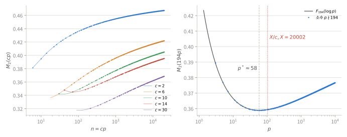

# $cp$ 계열의 이차 모멘트: 띠의 모양, 평균, 안정성

$n\mapsto M_2(n)$의 그래프에는 여러 개의 띠가 보인다. 각 띠는 고정된 정수 $c$에 소수 $p$를 곱한 계열 $n=cp$이다. 이 문서는 띠 하나의 정확한 모양, 두 띠의 차이, 띠 위 평균의 점근식과 그 예측기의 오차를 증명하고, 띠 분해를 전체 평균 $3/8$과 연결한다. 초기 수치 탐색 노트를 개정해 옮겼다. 절·명제·수식 번호는 이 문서 안에서 독립적이다.

기호는 [양의 약수분포의 이차 모멘트](m2-divisor-moment.md)를 따른다. $M_2(n)$은 그 문서의 (3.1), $b(n)=\sum_{d\mid n}\Lambda(d)\log d$는 (5.8)이다. 정수 $c\ge2$와 소수 $p$에 대해

$$
u=\log c,\qquad v=\log p,\qquad L=\log(cp)=u+v,\qquad t=\frac uL
$$

로 쓴다. 평균을 다룰 때는 $\lambda=\log X$, $Y=X/c$이다. 영점에 관한 결과는 쓰지 않는다. §5만 고전적 소수정리의 오차항(영점 없는 영역)을 쓴다.

| 결과 | 내용 | 범위 |
|:--|:--|:--|
| [명제 1.1](#section-1) | 띠의 정확식과 재귀형 $4M_2(cp)-1=(1-t)^2+t^2(4M_2(c)-1)$ | 정확한 항등식 |
| [명제 2.1](#section-2) | 띠의 U자 모양, 최소점 $p^*=e^{b(c)/\log c}\le c$와 최솟값 | 가정 없음 |
| [명제 3.1](#section-3) | 두 띠의 차: 정확한 분해와 안정성 부등식 | 가정 없음 |
| [정리 4.1](#section-4) | 띠 평균의 1차 법칙 $E_X(c)=\tfrac12-\frac{\log c}{2\log X}+O_c((\log X)^{-2})$ | Chebyshev 상하계 |
| [따름정리 4.2](#corollary-4-2) | 2차 항 $(u^2-2u+b(c))/(4\lambda^2)$ | 소수정리 |
| [정리 5.1](#section-5) | 소수정리 적분 예측기의 균등한 오차 상계 | 고전적 영점 없는 영역 |
| [명제 6.1](#section-6) | 정수 전체의 평균 $3/8$과 Poisson–Dirichlet(1) | 가정 없음 |
| [부록 A](#appendix-a) | 수치 기록 | 수치, 재현 가능 |

- [§1. 띠의 정확식](#section-1)
- [§2. 띠의 모양](#section-2)
- [§3. 두 띠의 비교](#section-3)
- [§4. 띠 위의 평균](#section-4)
- [§5. 소수정리 적분 예측기](#section-5)
- [§6. 띠 분해와 전체 평균](#section-6)
- [부록 A. 수치 기록](#appendix-a)
- [검산](#checks)

## 1. 띠의 정확식

[이차 모멘트 (3.1), (5.8)](m2-divisor-moment.md#section-3)에서 $n\ge2$에 대해

$$
M_2(n)=\frac14+\frac{b(n)}{4(\log n)^2},\qquad
b(n)=\sum_{q^a\parallel n}\frac{a(a+1)}2(\log q)^2,
\qquad
\operatorname{Var}(\log D_n)=\frac{b(n)}4
\tag{1.1}
$$

이다. $b$는 서로소 곱에 대해 가법적이다. $a=v_p(c)$이면

$$
b(cp)=b(c)+(a+1)(\log p)^2
\tag{1.2}
$$

이다. $a$에서 $a+1$로 갈 때 $\tfrac12[(a+1)(a+2)-a(a+1)]=a+1$이기 때문이다.

**명제 1.1.** $p\nmid c$이면

$$
\boxed{
M_2(cp)=F_c(v):=\frac14+\frac{v^2+b(c)}{4(u+v)^2}
=\frac12-\frac u{2L}+\frac{u^2+b(c)}{4L^2}
}
\tag{1.3}
$$

이고, 같은 식을 $t=u/L$로 쓰면

$$
\boxed{4M_2(cp)-1=(1-t)^2+t^2\bigl(4M_2(c)-1\bigr).}
\tag{1.4}
$$

**증명.** (1.3)은 (1.1)과 (1.2)에 $a=0$을 넣은 것이다. (1.1)에서 $b(c)=u^2(4M_2(c)-1)$이므로 $b(cp)/L^2=(v/L)^2+t^2(4M_2(c)-1)$이고 $v/L=1-t$이다. $\square$

**보조정리 1.2.** $c\ge2$이면 $0<b(c)\le(\log c)^2$이고, 등호는 $c$가 소수일 때만 성립한다.

**증명.** $a\ge1$에서 $a(a+1)/2\le a^2$이므로 $b(c)\le\sum a^2(\log q)^2\le(\sum a\log q)^2=(\log c)^2$이다. 첫 부등식의 등호는 모든 지수가 $1$일 때, 둘째는 소인수가 하나일 때만 성립한다. $\square$

띠 하나는 $c$의 두 불변량 $(\log c,\,b(c))$, 또는 동치로 $(\log c,\,M_2(c))$만으로 정해진다. 보조정리 1.2에서 $\tfrac14<F_c(v)<\tfrac12$ ($v>0$)이고 $p\to\infty$이면 $M_2(cp)\to\tfrac12$이다. 서로 다른 $c$의 계열은 겹칠 수 있다. 예를 들어 $210=30\cdot7=42\cdot5=70\cdot3$은 세 띠에 동시에 속한다. 겹치지 않는 분할은 §6.1에 둔다.

*왼쪽: $X=20002$까지 $c=2,6,10,14,30$의 점 $M_2(cp)$ ($p\nmid c$)와 실선 $F_c(\log(n/c))$. 오른쪽: $c=194$의 띠. 점선은 최소점 $p^*$, 빨간 점선은 $X=20002$에서 보이는 끝 $p=X/c$이다.*

## 2. 띠의 모양

**명제 2.1.** $c\ge2$, $b=b(c)$, $u=\log c$에 대해 $F_c$는 $v>0$에서

$$
F_c'(v)=\frac{uv-b}{2(u+v)^3}
\tag{2.1}
$$

를 만족한다. 따라서 $F_c$는 $(0,v^*]$에서 순감소, $[v^*,\infty)$에서 순증가하고

$$
\boxed{
v^*=\frac{b(c)}{\log c},\qquad
p^*:=e^{v^*}\le c,\qquad
\min_{v>0}F_c=\frac14+\frac{b}{4(b+u^2)}
=\frac14+\frac{4M_2(c)-1}{16M_2(c)}.
}
\tag{2.2}
$$

$p^*=c$는 $c$가 소수일 때만 성립한다. 또 $F_c(0^+)=M_2(c)$, $F_c(\infty)=\tfrac12$이다.

**증명.** 몫의 미분으로 $F_c'(v)=\frac{2v(u+v)-2(v^2+b)}{4(u+v)^3}$이고 분자는 $2(uv-b)$이다. $v=v^*$에서 $v^2+b=b(b+u^2)/u^2$, $(u+v)^2=(u^2+b)^2/u^2$이므로 최솟값은 $\tfrac14+\tfrac b{4(u^2+b)}$이다. $b=u^2(4M_2(c)-1)$을 넣으면 마지막 꼴이 된다. $p^*\le c$와 등호 조건은 보조정리 1.2이다. $\square$

따라서 $p\nmid c$인 소수 중에서 $M_2(cp)$는 $p\ge c$이면 $p$에 대해 순증가한다. $p<p^*$이면 오히려 순감소한다. "같은 $c$에서 $p$가 커질수록 띠가 올라간다"는 관찰은 $p\ge p^*$에서만 맞는다. $c=194=2\cdot97$이면 $p^*\approx58.2$이고 $M_2(194\cdot3)\approx0.3895>M_2(194\cdot59)\approx0.3589$이다. $X=20002$에서 이 띠는 $p\le103$까지만 보이므로 보이는 부분은 대부분 감소 구간이다(그림 오른쪽). $c=q$가 소수이면 $p^*=q$이고, 이는 $M_2(qp)$가 $p,q$에 대해 대칭이라는 사실과 맞는다.

## 3. 두 띠의 비교

$c_-<c_+$, $u_\pm=\log c_\pm$, $b_\pm=b(c_\pm)$, $L_\pm=v+u_\pm$로 두고 소수 $p\nmid c_-c_+$를 고정한다.

**명제 3.1.** 다음이 성립한다.

$$
\boxed{
M_2(c_-p)-M_2(c_+p)
=\frac{v^2+b_-}4\Bigl(\frac1{L_-^2}-\frac1{L_+^2}\Bigr)+\frac{b_--b_+}{4L_+^2}.
}
\tag{3.1}
$$

$$
|M_2(c_-p)-M_2(c_+p)|
\le\frac{v^2+b_-}4\Bigl(\frac1{L_-^2}-\frac1{L_+^2}\Bigr)+\frac{|b_--b_+|}{4L_+^2},
\tag{3.2}
$$

여기서 $b_-\ge b_+$이면 등호이다.

$$
\boxed{
|M_2(c_-p)-M_2(c_+p)|
\le\frac{\log(c_+/c_-)}{2\log(pc_+)}+\frac{|b(c_+)-b(c_-)|}{4\log^2(pc_+)}.
}
\tag{3.3}
$$

$p\ge p_0$이면 $p$에 무관하게

$$
|M_2(c_-p)-M_2(c_+p)|
\le\frac{\log(c_+/c_-)}{2\log(p_0c_+)}+\frac{|b(c_+)-b(c_-)|}{4\log^2(p_0c_+)}
\tag{3.4}
$$

이다. 유한한 소수 집합 $S$의 모든 원소가 $p\nmid c_-c_+$이면 $\overline M_S(c)=|S|^{-1}\sum_{p\in S}M_2(cp)$에 대해

$$
|\overline M_S(c_-)-\overline M_S(c_+)|
\le C_{1,S}\log\frac{c_+}{c_-}+C_{2,S}\,|b(c_+)-b(c_-)|,
\qquad
C_{k,S}=\frac1{|S|}\sum_{p\in S}\frac{1}{2^k\log^k(pc_+)}
\tag{3.5}
$$

이다.

**증명.** (3.1)은 (1.3)의 두 식을 빼고 $\pm(v^2+b_-)/(4L_+^2)$를 더한 것이다. 첫 항은 $L_-<L_+$에서 비음이므로 (3.2)와 등호 조건이 나온다. (3.3)은 (3.2)의 첫 항을 줄인다. 보조정리 1.2에서 $v^2+b_-\le v^2+u_-^2\le L_-^2$이므로

$$
\frac{v^2+b_-}4\Bigl(\frac1{L_-^2}-\frac1{L_+^2}\Bigr)
\le\frac{L_+^2-L_-^2}{4L_+^2}
=\frac{(L_+-L_-)(L_++L_-)}{4L_+^2}
\le\frac{u_+-u_-}{2L_+}
$$

이다. (3.4)는 $L_+\ge\log(p_0c_+)$, (3.5)는 (3.3)을 $S$에서 평균한 것이다. $\square$

초기 노트는 (3.3)의 첫 분모를 $\log(pc_-)$로 둔 꼴

$$
|M_2(c_-p)-M_2(c_+p)|
\le\frac{\log(c_+/c_-)}{2\log(pc_-)}+\frac{|b(c_+)-b(c_-)|}{4\log^2(pc_+)}
\tag{3.6}
$$

을 평균값 정리로 얻었다. (3.3)은 그보다 강하고, 증명에 평균값 정리가 필요 없다. 두 계열의 차는 $\log c$의 차와 $b$의 차로 제어된다. 둘이 모두 가까우면 띠가 거의 겹친다([부록 A.3](#appendix-a)).

서로 다른 $c_1\ne c_2$에서 $b(c_1)=b(c_2)$가 정확히 성립할 수 있는지는 $\{(\log q)^2\}$의 유리수 위 선형독립성 문제이다. 삼각수 $a(a+1)/2$는 단사이므로 $c_1\ne c_2$이면 계수 벡터가 $0$이 아니다. 선형독립성은 Schanuel 추측에서 따라 나오지만, 이 문서는 그 문제를 다루지 않는다. 수치 탐색의 근접 쌍은 수치적으로 가까울 뿐이다.

## 4. 띠 위의 평균

$X\ge2c$에서 소수 $p$를 균등하게 고르는 유한 모형을 쓴다.

$$
S_c(X):=\{p\ \text{소수}:\ p\nmid c,\ cp\le X\},\qquad
m_k(c,X):=\frac1{|S_c(X)|}\sum_{p\in S_c(X)}\frac1{(\log cp)^k},
\qquad
E_X(c):=\frac1{|S_c(X)|}\sum_{p\in S_c(X)}M_2(cp).
$$

$c$가 짝수이면 $p\nmid c$에서 $p\ge3$이 저절로 따라온다. 이 기대는 $p$의 균등 추출에 대한 것이고, 약수분포 $w_n(d)$ 아래의 기대와는 다른 연산이다. (1.3)을 평균하면 정확히

$$
\boxed{
E_X(c)=\frac12-\frac u2\,m_1+\frac{u^2+b(c)}4\,m_2
}
\tag{4.1}
$$

이다. 초기 노트의 분해 $E_X=G_X+H_X$는 $H_X=b(c)\,m_2/4$, $G_X=E_X-H_X$이다. $m_k$도 $S_c(X)$를 통해 $c$에 의존한다.

**정리 4.1.** $c\ge2$를 고정하고 $X\to\infty$이면

$$
m_1=\frac1\lambda+O_c(\lambda^{-2}),\qquad
m_2=\frac1{\lambda^2}+O_c(\lambda^{-3}),\qquad
\boxed{E_X(c)=\frac12-\frac{\log c}{2\log X}+O_c\bigl((\log X)^{-2}\bigr).}
\tag{4.2}
$$

**증명.** $p\in S_c(X)$에 대해 $\delta_p:=\log(Y/p)=\lambda-\log(cp)\ge0$로 둔다. Chebyshev 상하계 $\pi(t)\asymp t/\log t$만 쓴다.

(i) $\sum_{p\le Y}\delta_p=\int_2^Y\pi(t)\,dt/t\ll Y/\log Y$이고 $\sum_{p\le Y}\delta_p^2=\int_2^Y2\log(Y/t)\,\pi(t)\,dt/t\ll Y/\log Y$이다. 둘째 적분은 $\sqrt Y$에서 나누면 된다. $Y\ge Y_0(c)$이면 $|S_c(X)|\ge\pi(Y)-\omega(c)\gg Y/\log Y$이므로 $\delta_p$와 $\delta_p^2$의 $S_c(X)$ 위 평균은 $O_c(1)$이다.

(ii) $p\le\sqrt Y$인 소수는 $\sqrt Y$개 이하이고, 각 항은 $L\ge\log4>1$에서 $1$ 이하이므로 평균에 $O(\log Y/\sqrt Y)$만 준다. $p>\sqrt Y$이면 $L\ge u+\tfrac12\log Y=\tfrac12(\lambda+u)\ge\lambda/2$이므로

$$
0\le\frac1L-\frac1\lambda=\frac{\delta_p}{L\lambda}\le\frac{2\delta_p}{\lambda^2},
\qquad
0\le\frac1{L^2}-\frac1{\lambda^2}=\frac{\delta_p(L+\lambda)}{L^2\lambda^2}\le\frac{8\delta_p}{\lambda^3}.
$$

(i)로 평균하면 $m_1,m_2$의 식을 얻는다. $\log Y=\lambda-u$이므로 $O(\log Y/\sqrt Y)$는 이 오차에 들어간다. 이를 (4.1)에 넣는다. $\square$

**따름정리 4.2.** 같은 조건에서

$$
\boxed{
E_X(c)=\frac12-\frac{u}{2\lambda}+\frac{u^2-2u+b(c)}{4\lambda^2}+O_c(\lambda^{-3}).
}
\tag{4.3}
$$

**증명.** 소수정리 $\pi(t)=t/\log t+t/\log^2t+O(t/\log^3t)$에서 $\sum_{p\le Y}\delta_p=\int_2^Y\pi(t)\,dt/t=Y/\log Y+2Y/\log^2Y+O(Y/\log^3Y)$이므로 $\delta_p$의 평균은 $1+O(1/\log Y)$이다. $p\mid c$인 소수를 빼면 합이 $O_c(\log Y)$만 바뀐다. $p>\sqrt Y$에서

$$
\frac1L=\frac1\lambda+\frac{\delta_p}{\lambda^2}+\frac{\delta_p^2}{L\lambda^2},\qquad
0\le\frac{\delta_p^2}{L\lambda^2}\le\frac{2\delta_p^2}{\lambda^3}
$$

이고 $\delta_p^2$의 평균은 $O_c(1)$이므로 $m_1=\lambda^{-1}+\lambda^{-2}+O_c(\lambda^{-3})$이다. 정리 4.1의 $m_2$와 함께 (4.1)에 넣는다. $\square$

띠의 순서는 1차로 $\log c$가 정한다. $b(c)$는 $\lambda^{-2}$ 차수에서 계수 $m_2/4=\tfrac1{4\lambda^2}(1+O_c(\lambda^{-1}))$로만 들어간다. $b$가 거의 같아도 $\log c$가 다르면 평균이 $\Delta\log c/(2\lambda)$ 규모로 벌어진다. 초기 노트가 관찰한 기울기 $H_X\approx0.0034\,b(c)$의 $0.0034$는 50개 띠에서 평균한 $m_2/4$이다. 상수가 아니라 $1/(4\lambda^2)\approx0.0025$에 $O(\lambda^{-1})$ 보정이 붙은 값이다([부록 A.4](#appendix-a)).

## 5. 소수정리 적분 예측기

$\operatorname{li}(t):=\int_2^t ds/\log s$, $g_c(t):=F_c(\log t)$, $\mathcal Q_c(Y):=\{q\ \text{소수}:q\mid c,\ q\le Y\}$로 두고

$$
\widehat E_X(c):=
\frac{\displaystyle\int_2^Y\frac{g_c(t)}{\log t}\,dt-\sum_{q\in\mathcal Q_c(Y)}g_c(q)}
{\operatorname{li}(Y)-|\mathcal Q_c(Y)|}
\tag{5.1}
$$

로 정의한다. 초기 노트는 짝수 $c$에서 적분 하한을 $3$으로, 빼는 소수를 홀수 $q$로 둔 꼴을 썼다.

$$
\widehat E^{\rm odd}_X(c):=
\frac{\int_3^Yg_c(t)\,dt/\log t-\sum_{q\in\mathcal Q_c(Y),\,q\ne2}g_c(q)}
{\int_3^Ydt/\log t-|\mathcal Q_c(Y)\setminus\{2\}|}.
\tag{5.2}
$$

(5.2)의 분자와 분모는 (5.1)과 $O(1)$씩 다르다. 따라서 두 예측기의 차는 $O(\log Y/Y)$이다.

**정리 5.1.** 절대상수 $a>0$, $Y_0$가 있어, $Y\ge Y_0$이고 $\omega(c)\le Y/(4\log Y)$인 모든 $c\ge2$에 대해

$$
\boxed{|E_X(c)-\widehat E_X(c)|\ll\log Y\cdot e^{-a\sqrt{\log Y}}}
\tag{5.3}
$$

이다. 함축 상수는 $c$에 의존하지 않는다.

**증명.** $N=\sum_{p\in S_c(X)}g_c(p)$, $D=|S_c(X)|$로 두고 $\widetilde N,\widetilde D$를 (5.1)의 분자와 분모라 하자. $p\mid c$인 소수의 제외는 양쪽에서 같은 항을 빼므로 정확히 상쇄되고, $R:=\pi-\operatorname{li}$에 대해

$$
N-\widetilde N=\int_{2^-}^Yg_c\,dR=g_c(Y)R(Y)-\int_2^Yg_c'(t)R(t)\,dt
$$

이다. 보조정리 1.2에서 $|uv-b|\le uv+u^2$이므로 (2.1)은

$$
|\partial_vF_c|\le\frac{u(u+v)}{2L^3}=\frac u{2L^2}\le\frac1{2L},
\qquad
|g_c'(t)|\le\frac1{2t\log t}
$$

를 준다. 이 상계는 $c$에 의존하지 않는다. 또 $\tfrac14\le g_c\le\tfrac12$이다. 고전적 소수정리 $R(t)\ll t\,e^{-a_0\sqrt{\log t}}$ [2, 6장]에서

$$
|N-\widetilde N|\le\tfrac12|R(Y)|+\int_2^Y\frac{|R(t)|}{2t\log t}\,dt\ll Y e^{-a\sqrt{\log Y}}
$$

이다. 적분은 $\sqrt Y$에서 나누면 되고, $a=a_0/\sqrt2$로 잡는다. $g_c\equiv1$로 같은 계산을 하면 $|D-\widetilde D|$도 같은 상계를 갖는다. $\operatorname{li}(Y)\ge Y/\log Y$ ($Y\ge Y_0$)와 $\omega(c)\le Y/(4\log Y)$에서 $\widetilde D\ge\tfrac34Y/\log Y$이고, $Y_0$를 키우면 $D>0$이다. 마지막으로 $0\le N/D\le\tfrac12$이므로

$$
\Bigl|\frac ND-\frac{\widetilde N}{\widetilde D}\Bigr|
=\Bigl|\frac{N-\widetilde N}{\widetilde D}+\frac ND\cdot\frac{\widetilde D-D}{\widetilde D}\Bigr|
\le\frac{|N-\widetilde N|+\tfrac12|D-\widetilde D|}{\widetilde D}. \qquad\square
$$

증명에는 고전적 영점 없는 영역만 쓰였고 개별 영점은 들어가지 않는다. RH를 가정하면 $R(t)\ll\sqrt t\log t$에서 우변이 $Y^{-1/2}\log^2Y$가 된다. 그러나 이 문서의 결과는 RH를 연구하는 데 쓰이므로 그 가정은 쓰지 않는다.

## 6. 띠 분해와 전체 평균

### 6.1. 겹치지 않는 분할

$P^+(n)$을 $n$의 가장 큰 소인수($P^+(1)=1$)라 하고 $\mathcal N:=\{n\ge2:P^+(n)^2\mid n\}$로 둔다. $n\ge2$, $n\notin\mathcal N$은 $n=cp$, $p=P^+(n)>P^+(c)$로 유일하게 쓰인다. $c=1$이면 $F_1\equiv\tfrac12$이다. 따라서 정확히

$$
T_2(x)=\sum_{c\ge1}\ \sum_{P^+(c)<p\le x/c}F_c(\log p)\;+\sum_{\substack{n\le x\\ n\in\mathcal N}}M_2(n)
\tag{6.1}
$$

이다. 임의의 $y$에서 $|\mathcal N\cap[1,x]|\le\sum_{p>y}x/p^2+\Psi(x,y)\le x/y+\Psi(x,y)$이므로, $y=e^{\sqrt{\log x}}$로 잡으면 $|\mathcal N\cap[1,x]|=o(x)$이다. 다만 이 $o(x)$는 $\sqrt x$보다 훨씬 크다. 그래서 (6.1)만으로는 [$\mathcal E_2$](m2-divisor-moment.md#section-4)에 관한 정보를 얻지 못한다. $\mathcal E_2$의 성장은 [이차 모멘트 §8, §10](m2-divisor-moment.md#section-8)처럼 디리클레급수와 $\psi$를 통해 다룬다.

### 6.2. 평균 $3/8$의 해석

$p=P^+(n)\parallel n$이면 (1.4)에서 $V_1:=\log P^+(n)/\log n=1-t$이고

$$
4M_2(n)-1=V_1^2+(1-V_1)^2\bigl(4M_2(n/P^+(n))-1\bigr)
$$

이다. 가장 큰 막대를 떼어내는 막대 자르기 재귀이다.

**명제 6.1 (가정 없음).** $x\to\infty$이면 $\frac1x\sum_{2\le n\le x}\bigl(4M_2(n)-1\bigr)\to\frac12$이고, 따라서 $M_2$의 평균은 $\tfrac38$로 간다.

이 극한 자체는 [이차 모멘트 (9.1)](m2-divisor-moment.md#section-9)에 오차항까지 이미 있다. 여기서는 $3/8$이 어디서 오는지를 소인수 크기의 극한분포로 설명한다.

**증명.** $n=p_1p_2\cdots p_k$ ($p_1\ge p_2\ge\cdots$, 중복 포함)로 쓰고 $V_i=\log p_i/\log n$ ($i>k$이면 $0$)로 둔다. (1.1)에서

$$
\frac{b(n)}{(\log n)^2}=\sum_iV_i^2+s(n),\qquad
s(n):=\sum_{q^a\parallel n}\frac{a(a-1)}2\frac{(\log q)^2}{(\log n)^2}\ge0
$$

이다.

(i) Billingsley [1]에 따르면 $n$을 $[1,x]$에서 균등하게 뽑을 때 $(V_1,V_2,\dots)$는 곱위상에서 Poisson–Dirichlet(1) 분포로 수렴한다. $\Phi(v)=\sum v_i^2$는 $\{v_1\ge v_2\ge\cdots\ge0,\ \sum v_i\le1\}$에서 곱위상에 대해 연속이고 유계이다. 꼬리가 $\sum_{i>k}v_i^2\le v_k\le1/k$로 균등하게 작기 때문이다. 따라서 평균은 $\mathbb E_{\rm PD(1)}\sum V_i^2$로 간다. 이 값은 크기편향 추출 $V^*$의 평균과 같고, PD(1)에서 $V^*$는 $(0,1)$ 위 균등분포이므로 $\tfrac12$이다.

(ii) $r(n):=\prod_{q^a\parallel n,\,a\ge2}q^a$로 두면 $s(n)\le(\log r(n))^2/(\log n)^2\le\log r(n)/\log n$이다. $a\ge2$에서 $a\log q\le2\sum_{k=2}^a\log q$이므로 $\sum_{n\le x}\log r(n)\le2x\sum_q\sum_{k\ge2}\log q/q^k\ll x$이다. $n\le\sqrt x$를 따로 세면 $\frac1x\sum_{n\le x}s(n)\ll1/\log x$이다. $\square$

## 부록 A. 수치 기록

모든 값은 [check_cp_families.py](../scripts/check_cp_families.py)가 원자료 없이 다시 계산한다. 초기 노트의 보고값과 소수점 아래 표시 자리까지 일치한다.

**A.1–A.2. 띠 평균 ($X=20002$).** $G=E-H$, $H=b(c)\,m_2/4$.

| $c$ | $\lvert S_c(X)\rvert$ | $b(c)$ | $G$ | $H$ | $E_X(c)$ |
|---:|---:|---:|---:|---:|---:|
| 2 | 1,228 | 0.480453 | 0.461012 | 0.001753 | 0.462765 |
| 6 | 468 | 1.687402 | 0.406474 | 0.005993 | 0.412467 |
| 10 | 301 | 3.070743 | 0.383981 | 0.010892 | 0.394873 |
| 14 | 223 | 4.267019 | 0.370030 | 0.015149 | 0.385178 |
| 30 | 118 | 4.277692 | 0.342940 | 0.014543 | 0.357483 |
| 90 | 44 | 6.691590 | 0.309577 | 0.022194 | 0.331771 |
| 102 | 41 | 9.714500 | 0.306486 | 0.032242 | 0.338727 |

$b(14)\approx b(30)$이지만 평균은 $0.028$ 차이가 난다(정리 4.1의 $\Delta\log c/(2\lambda)$ 규모). $90\to102$에서는 $b$ 항의 증가가 로그 항의 감소보다 커서 평균이 오른다.

**A.3. $b$가 가까운 쌍.** 두 $c$를 모두 나누지 않는 홀수 소수 $p\le10^5$에서의 평균이다.

| $c$ | 소인수분해 | $\log c$ | $b(c)$ | 평균 $M_2(cp)$ | 소수 개수 |
|---:|:--|---:|---:|---:|---:|
| 57450 | $2\cdot3\cdot5^2\cdot383$ | 10.958670 | 44.837393389 | 0.333925280 | 9,586 |
| 24634 | $2\cdot109\cdot113$ | 10.111883 | 44.837393555 | 0.341004437 | 9,586 |
| 89358 | $2\cdot3\cdot53\cdot281$ | 11.400406 | 49.241663231 | 0.332897322 | 9,585 |
| 89362 | $2\cdot7\cdot13\cdot491$ | 11.400451 | 49.241904357 | 0.332897110 | 9,585 |

첫 쌍은 $|\Delta b|\approx1.7\times10^{-7}$인데 평균 차가 $7.08\times10^{-3}$이다. 둘째 쌍은 $\log c$도 가까워 차가 $2.13\times10^{-7}$이다.

**A.4. 안정성 부등식과 예측기 ($X=20002$, $c=2,6,\dots,198$의 50개 띠).**

- 1,225쌍 모두에서 점별 사슬 $|\Delta M_2|\le$ (3.2) $\le$ (3.3) $\le$ (3.6)이 성립하고, $b_-\ge b_+$이면 (3.2)가 등호이다.
- 실제 평균 차를 (3.5)의 상계로 나눈 비는 최대 $0.983389$, 평균 $0.306977$이다. (3.6)을 평균한 상계로는 최대 $0.983320$, 평균 $0.285474$이다.
- 최대 비는 $(c_-,c_+)=(194,198)$에서 나온다. 공통 소수는 22개이고, 평균 차 $0.0379875$, (3.5)의 상계 $0.0386292$이다. $b(194)>b(198)$이고 $\log(198/194)$가 작아 상계가 거의 등호가 된다.
- 예측기 (5.2)의 오차: MAE $0.0003081$, RMSE $0.0003412$, 최대 $0.0007099$.
- $m_2/4$의 50개 띠 평균은 $0.003400$이다. $1/(4\lambda^2)=0.002549$, $1/(4(\lambda-1)^2)=0.003154$와 비교된다.

**A.5. 정리 4.1과 따름정리 4.2.** 각 칸은 $\lambda^2(E_X-\text{1차식})$, $\lambda^3(E_X-\text{(4.3)의 2차식})$이다. 첫 값은 $(u^2-2u+b)/4$ ($c=2,6,30$에서 $-0.106,\ +0.329,\ +2.261$)로 천천히 다가가고, 둘째 값은 유계로 남는다.

| $c$ | $X=10^5$ | $10^6$ | $10^7$ | $10^8$ |
|---:|:--|:--|:--|:--|
| 2 | −0.198, −1.056 | −0.174, −0.937 | −0.159, −0.851 | −0.150, −0.795 |
| 6 | +0.270, −0.669 | +0.276, −0.725 | +0.289, −0.642 | +0.298, −0.566 |
| 30 | +2.639, +4.352 | +2.504, +3.365 | +2.452, +3.073 | +2.423, +2.988 |

**A.6. 명제 6.1.** $x=10^6$에서 $M_2$의 평균은 $0.386166$이다. [이차 모멘트 (9.1)](m2-divisor-moment.md#section-9)의 처음 세 항 $\tfrac38+\tfrac{\gamma}{4L}+\tfrac{\gamma-\gamma^2-3\gamma_1}{4L^2}\approx0.3861$과 맞는다. $s(n)$의 평균은 $0.008561$이다.

## 검산

[검산 스크립트](../scripts/check_cp_families.py)는 numpy와 scipy를 사용하며 다음을 확인한다.

- (1.1): $n\le3000$에서 약수합 정의와 $10^{-15}$ 안에서 맞는다. (1.2)–(1.4)는 $c<400$과 처음 60개 소수에서 맞는다. 보조정리 1.2는 $c<10^4$에서 확인한다.
- 명제 2.1: $c\le2000$에서 U자 모양, $p^*\le c$, 최솟값의 닫힌 꼴.
- 명제 3.1: 1,225쌍에서 (3.1)의 항등식과 부등식 사슬.
- 부록 A의 모든 표. `--figure`로 위 그림을 다시 만든다.

수치 확인은 증명을 대체하지 않는다.

    python -B scripts/check_cp_families.py
    python -B scripts/check_cp_families.py --figure docs/figures/m2-cp-bands.svg

## 참고 문헌

1. P. Billingsley, *On the distribution of large prime divisors*, Period. Math. Hungar. 2 (1972), 283–289.
2. H. L. Montgomery, R. C. Vaughan, *Multiplicative Number Theory I*, Cambridge (2007), 6장(소수정리의 오차항).
