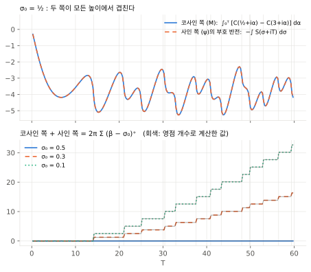
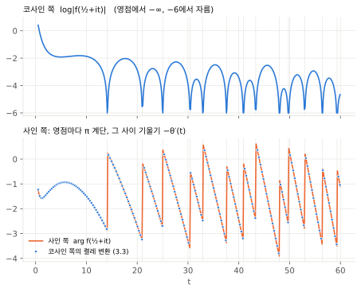
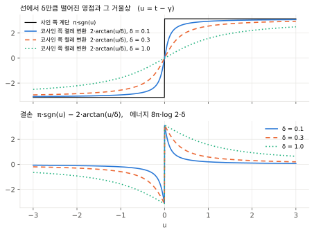

# 사인과 코사인으로 쓴 RH 판정법

[M과 ψ](mertens-psi.md)에서 $M$은 소수마다 코사인 동전을, $\psi$는 사인 동전을 가졌다. 로그를 취하면 두 동전은 $\log\zeta$의 실수부와 허수부, 곧 조화 켤레가 된다. 이 문서는 두 쪽이 **정확히 상쇄된다**는 조건으로 RH를 두 가지로 쓴다. 판정법 1은 Littlewood 보조정리의 직사각형 판이고, 판정법 2는 임계선 위의 켤레 변환 판이다. 절·명제·수식 번호는 이 문서 안에서 독립적이다.

두 변수 변환 $\widetilde D_{z,w}(s,t)=\zeta(s)^z\zeta(t)^w$는 [주정리 (8.5)](main-theorem.md#equation-8-5)를 따르고, $s=\sigma+i\alpha$에 대해 $\mathfrak D^{z,w}(s):=\widetilde D_{z,w}(\bar s,s)$로 둔다. 이는 [M과 ψ (3.1)](mertens-psi.md#equation-3-1)의 두 변수 형태이다. [주정리 부록 A.3](main-theorem.md#appendix-a-3)과 같이 $Z(s)=(s-1)\zeta(s)$로 쓰고, $f(s)=Z(s)/s^2$로 둔다. $Z$와 $f$는 $(\tfrac12,\infty)$에서 양수이다. 로그는 모두 오른쪽에서 수평으로 이어 붙인 가지이며 실수축 위에서 실수이다.

$$
\mathcal C(s)=\log|Z(s)|,\qquad \mathcal S(s)=\arg Z(s),\qquad
\nu(\sigma,T)=\#\{\rho=\beta+i\gamma:\ \beta>\sigma,\ 0<\gamma\le T\}
$$

$\mathcal C$를 **코사인 쪽**, $\mathcal S$를 **사인 쪽**이라 부른다. $\nu$는 중복도를 포함해 센다.

| 결과 | 내용 | 범위 |
|:--|:--|:--|
| [(1.1)–(1.3)](#section-1) | 로그 동전: 코사인 쪽이 $M$, 사인 쪽이 $\psi$이고 둘은 조화 켤레 | 정확한 항등식 |
| [판정법 1](#section-2) | Littlewood 상쇄: 임계선에서 두 쪽이 모든 높이에서 상쇄되는 것과 RH가 동치 | 가정 없음 |
| [판정법 2](#section-3) | 켤레 변환: 임계선 위 사인 쪽이 코사인 쪽의 켤레 변환인 것과 RH가 동치 | 가정 없음 |
| [(3.5)–(3.6)](#section-3-2) | 선 밖 영점의 결손 모양과 에너지 $8\pi\log2\cdot\delta$ | **[국소 계산]** |

- [§1. 로그 동전과 켤레성](#section-1)
- [§2. 판정법 1: Littlewood 상쇄](#section-2)
- [§3. 판정법 2: 임계선 위의 켤레 변환](#section-3)
- [§4. 높이와 평균](#section-4)
- [검산](#checks)
- [참고 문헌](#references)

## 1. 로그 동전과 켤레성

$\log\zeta(\sigma\mp i\alpha)=\sum_n\frac{\Lambda(n)}{\log n}n^{-\sigma}e^{\pm i\alpha\log n}$에서, $\sigma>1$이면

$$
\log\mathfrak D^{z,w}(\sigma+i\alpha)
=\sum_{n\ge2}\frac{\Lambda(n)}{\log n}\,n^{-\sigma}\Big[(z+w)\cos(\alpha\log n)+i(z-w)\sin(\alpha\log n)\Big]
\tag{1.1}
$$

이다. [M과 ψ (1.4)](mertens-psi.md#equation-1-4)의 동전 분해는 제곱 인수 없는 $n$에서의 곱셈꼴이었다. 로그를 취하면 모든 $n$에서 정확한 덧셈꼴이 된다. 특히

$$
\log\mathfrak D^{-1/2,-1/2}=-\log|\zeta|,\qquad
\log\mathfrak D^{-1/2,1/2}=i\arg\zeta
\tag{1.2}
$$

이고, 따라서 $\mathcal C=-\log\mathfrak D^{-1/2,-1/2}+\log|s-1|$, $\mathcal S=-i\log\mathfrak D^{-1/2,1/2}+\arg(s-1)$이다. 코사인 쪽은 $M$의 지수 $(-\tfrac12,-\tfrac12)$에서, 사인 쪽은 $\psi$의 지수 $(-\tfrac12,\tfrac12)$에서 나온다. 각 항 $n^{-s}$의 실수부와 허수부가 조화 켤레이므로, $Z\ne0$인 곳에서는 Cauchy–Riemann 방정식

$$
\partial_\sigma\mathcal C=\partial_\alpha\mathcal S,\qquad
\partial_\alpha\mathcal C=-\partial_\sigma\mathcal S
\tag{1.3}
$$

이 해석적 연속으로 유지된다. 이 관계가 깨지는 곳은 영점뿐이다. 중복도 $m$인 영점에서 $\mathcal C$는 $m\log|s-\rho|$처럼 $-\infty$로 가고, $\mathcal S$는 한 바퀴에 $2\pi m$만큼 감긴다.

## 2. 판정법 1: Littlewood 상쇄

**명제 2.1 (Littlewood 보조정리의 M–ψ판).** $0<\sigma_0<1<\sigma_1$이고 $T>0$이 영점의 높이가 아니면

$$
\underbrace{\int_0^T\big[\mathcal C(\sigma_0+i\alpha)-\mathcal C(\sigma_1+i\alpha)\big]\,d\alpha}_{\text{코사인 쪽 }(M)}
+\underbrace{\int_{\sigma_0}^{\sigma_1}\mathcal S(\sigma+iT)\,d\sigma}_{\text{사인 쪽 }(\psi)}
=2\pi\sum_{0<\gamma\le T}(\beta-\sigma_0)^+
\tag{2.1}
$$

이다. RH를 쓰지 않는다.

**증명.** 직사각형 $[\sigma_0,\sigma_1]\times[0,T]$의 경계에서 $\log Z$를 적분하면 Littlewood 보조정리에 의해 $-2\pi i\int_{\sigma_0}^{\sigma_1}\nu(\sigma,T)\,d\sigma$가 된다(Titchmarsh §9.9). 아래 변에서는 $Z>0$이므로 허수부가 없다. 허수부를 비교하고 $\int_{\sigma_0}^{\sigma_1}\nu\,d\sigma=\sum(\beta-\sigma_0)^+$를 쓰면 (2.1)이다. 가지의 규약은 [Ng 쌍대 §3.1](ng-duality.md#section-3-1)과 같다. $\sigma_0=\tfrac12$이면 왼쪽 변 위의 영점은 적분 가능한 로그 특이점이므로 $\sigma_0\downarrow\tfrac12$의 극한으로 (2.1)이 성립한다. $\square$

**판정법 1.** 다음은 동치이다.

1. RH.
2. 영점의 높이가 아닌 모든 $T>0$에서

$$
\boxed{
\int_0^T\big[\mathcal C(\tfrac12+i\alpha)-\mathcal C(\sigma_1+i\alpha)\big]\,d\alpha
=-\int_{1/2}^{\sigma_1}\mathcal S(\sigma+iT)\,d\sigma.
}
\tag{2.2}
$$

3. $T_k\to\infty$인 어떤 수열을 따라 (2.2)가 성립한다.

즉 임계선에서 코사인 쪽과 사인 쪽이 정확히 상쇄된다.

**증명.** $\sigma_0=\tfrac12$에서 (2.1)의 오른쪽은 $2\pi\sum_{0<\gamma\le T}(\beta-\tfrac12)^+$이다. 각 항은 음이 아니고, $\beta>\tfrac12$일 때만 양수이다. 함수방정식에 의해 선 밖 영점에는 항상 $\beta>\tfrac12$인 짝이 있다. 오른쪽은 $T$에 대해 감소하지 않으므로 한 수열을 따라 $0$이면 모든 $T$에서 $0$이다. $\square$

결손이 음이 아닌 항의 합이라는 점이 판정력의 원천이다. 선 밖 영점 하나가 만든 어긋남은 다른 영점이 되돌릴 수 없다. [Ng 쌍대 §3.3](ng-duality.md#section-3-3)의 보조정리 3.2와 같은 양성이다.

그림 1에서 $\sigma_1=3$이다. 위 칸은 $\sigma_0=\tfrac12$의 코사인 쪽과, 부호를 바꾼 사인 쪽이다. 두 곡선은 모든 높이에서 겹치고, 영점(세로 회색 선)을 지날 때 같은 모양으로 꺾인다. 아래 칸은 두 쪽의 합이다. $\sigma_0=\tfrac12$에서는 $0$이고, 선 왼쪽의 $\sigma_0$에서는 영점마다 $2\pi(\tfrac12-\sigma_0)$씩 올라가는 계단이 회색 이론값과 겹친다.

**[수치]** $\sigma_1=3$, $T=50$(영점 10개).

| $\sigma_0$ | 코사인 쪽 | 사인 쪽 | 합 | $2\pi\sum(\beta-\sigma_0)^+$ |
|:--|--:|--:|--:|--:|
| $0.6$ | $-4.49054$ | $+4.49054$ | $0.00000$ | $0$ |
| $0.5$ | $-4.80692$ | $+4.80734$ | $0.00042$ | $0$ |
| $0.3$ | $+6.99625$ | $+5.57012$ | $12.56637$ | $2\pi\cdot0.2\cdot10$ |
| $0.1$ | $+18.68767$ | $+6.44507$ | $25.13274$ | $2\pi\cdot0.4\cdot10$ |

$\sigma_0=\tfrac12$ 행의 $4\times10^{-4}$는 왼쪽 변 위 로그 특이점의 수치 적분 오차이다. $T\le60$ 전체에서 $\sigma_0=\tfrac12$의 합은 $6\times10^{-4}$ 이내이다.

## 3. 판정법 2: 임계선 위의 켤레 변환

**명제 3.1 (켤레 변환 공식).** $\Re s_0>\tfrac12$이면

$$
\log f(s_0)=\frac1\pi\int_{-\infty}^{\infty}\frac{\log|f(\tfrac12+it)|}{s_0-\tfrac12-it}\,dt+\log B(s_0),
\tag{3.1}
$$

$$
B(s)=\prod_{\beta>1/2,\ \gamma>0}\frac{(s-\beta)^2+\gamma^2}{(s-1+\beta)^2+\gamma^2}
\tag{3.2}
$$

이다. 곱은 중복도를 포함한 선 밖 영점에 대한 것이고, 적분의 허수부는 대칭 절단 $\int_{-T}^{T}$의 극한이다. RH를 쓰지 않는다.

적분 핵의 실수부는 Poisson 핵이고 허수부는 켤레 Poisson 핵이다. 즉 임계선 위의 코사인 쪽 $\log|f|$ 하나가 내부의 코사인 쪽과 사인 쪽을 모두 만들고, 그 차이가 $\log B$이다. $\sigma_0>1$이면 왼쪽은 (1.1)의 동전 급수이다.

**증명.** $f$는 반평면 $\Re s>\tfrac12$의 Hardy 공간 $H^2$에 속하고, 그 내부–외부 분해에는 특이 내부 인자가 없다(Burnol, Balazard–Saias–Yor). 따라서 $f=B\cdot O$이고, $O$는 경계값 $\log|O|=\log|f|$의 Schwarz 적분을 지수로 갖는 외부 함수이다. (3.2)의 각 인자는 영점 쌍 $\rho,\bar\rho$의 Blaschke 인자의 곱이다. 이 인자는 $(\tfrac12,\infty)$에서 $(0,1)$ 안의 실수이고, 임계선 위에서 절댓값이 $1$이다. $1$과의 차이는 $O\big((\beta-\tfrac12)/\gamma^2\big)$이므로 곱이 수렴한다. $f$, $B$, 그리고 짝함수 $\log|f(\tfrac12+it)|$의 Schwarz 적분이 모두 $(\tfrac12,\infty)$에서 실수이므로 상수 위상은 $0$이다. $\square$

**판정법 2.** 다음은 동치이다.

1. RH.
2. $B\equiv1$.
3. (코사인 쪽, 한 점) $s_0=1$에서 (3.1)의 실수부가 $0$이다. 즉 $\int\log|f(\tfrac12+it)|\,\frac{dt}{\frac14+t^2}=0$이다. 이는 Balazard–Saias–Yor 판정식과 같다.
4. (사인 쪽, 임계선 위) 거의 모든 $\alpha$에서

$$
\boxed{
\arg f(\tfrac12+i\alpha)=\frac1\pi\,\mathrm{p.v.}\!\int_{-\infty}^{\infty}\frac{\log|f(\tfrac12+it)|}{t-\alpha}\,dt
}
\tag{3.3}
$$

이다. 즉 임계선 위의 사인 쪽이 코사인 쪽의 켤레 변환(Hilbert 변환)이다.

**증명.** 1과 2의 동치는 (3.2)에서 바로 나온다. 2에서 3은 $f(1)=1$이고, 3에서 2는 $(\tfrac12,\infty)$에서 $0<B<1$이라는 데서 나온다. 2에서 4는 (3.1)의 허수부를 경계로 보낸 극한이다. 4에서 2를 보이자. 선 밖 영점이 있으면, 수평으로 이어 붙인 가지에서 $\arg B(\tfrac12+i\alpha)$는 그 높이 $\gamma$에서 $2\pi$의 정수배만큼 뛴다. 나머지 인자들은 그 근방에서 연속이므로, (3.3)이 양의 측도 집합에서 깨진다. $\square$

두 결손의 성격은 다르다.

- **코사인 쪽 결손** $\log|B(s_0)|$은 실수축 위에서 각 인자가 음수이다. 상쇄될 수 없으므로 한 점(3)으로 판정이 끝난다.
- **사인 쪽 결손** $\arg B(s_0)$은 영점 쌍의 대칭 때문에 실수축 위에서 항상 $0$이고, 그 밖에서는 영점의 위아래에 따라 부호가 섞인다. 사인 쪽의 주기적 상쇄는 실제로 일어나며, 바로 그 때문에 판정에는 임계선 전체(4)가 필요하다.

### 3.2. 임계선 위에서 맞물리는 방식

사인 쪽은 RH와 무관하게 톱니파이다. Riemann–von Mangoldt 공식 $N(t)=\theta(t)/\pi+1+S(t)$에서

$$
\arg\zeta(\tfrac12+it)=\pi S(t)=\pi\big(N(t)-1\big)-\theta(t)
\tag{3.4}
$$

이다. 따라서 사인 쪽은 영점마다 중복도만큼 $\pi$씩 뛰고, 그 사이에서는 기울기 $-\theta'(t)\approx-\tfrac12\log(t/2\pi)$로 내려간다. 평균 간격과 기울기의 곱이 $\pi$이므로 톱니는 한쪽으로 흘러가지 않는다.

**선 위의 영점.** $\rho=\tfrac12+i\gamma$ 근처에서 $\mathcal C\approx\log|t-\gamma|$, $\mathcal S\approx\tfrac\pi2\,\mathrm{sgn}(t-\gamma)$(상수 차이 무시)이다. 둘은 $\log(s-\rho)$의 경계값의 실수부와 허수부, 곧 정확한 켤레쌍이다. $\rho$가 경계 위에 있으므로 $\log(s-\rho)$는 내부에서 해석적이다. 다시 말해 선 위의 영점은 자기 자신의 거울상($\rho=1-\bar\rho$)이고 (3.2)에 나타나지 않는다.

**선 밖의 영점.** $\rho=\tfrac12+\delta+i\gamma$이고 $u=t-\gamma$라 하자. 임계선 위에서 $|s-\rho|=|s-(1-\bar\rho)|$이므로 코사인 쪽은 영점이 선의 어느 쪽에 있는지 구분하지 못한다. 골짜기는 $\log(u^2+\delta^2)$로 무뎌지고, 그 켤레 변환은 폭 $\delta$로 번진 계단 $2\arctan(u/\delta)$이다. 반면 사인 쪽은 (3.4)에 따라 $\rho$와 거울상 $1-\bar\rho$를 함께 세어 날카로운 $2\pi$ 계단을 갖는다. 그 차이가 $\rho$의 Blaschke 인자가 경계에서 갖는 편각이다.

$$
\pi\,\mathrm{sgn}(u)-2\arctan\frac u\delta
\tag{3.5}
$$

$$
\int_{-\infty}^{\infty}\Big(\pi\,\mathrm{sgn}(u)-2\arctan\frac u\delta\Big)^2du=8\pi\log2\cdot\delta
\tag{3.6}
$$

(3.6)은 $\int_0^\infty(\arctan x/x)^2dx=\pi\log2$에서 나온다. 같은 영점이 (2.1)에 남기는 양은 $2\pi\delta$이다. 결국 임계선 위의 상쇄 조건은 **사인 톱니의 계단 하나하나를 코사인 골짜기가 번짐 없이 재현하는 것**이고, 번짐의 폭이 선까지의 거리이다. 이 대응은 RH의 수치 검증에 쓰는 Turing의 방법, 곧 부호 변화로 찾은 선 위 영점의 수를 $N(T)$와 맞추는 방식과 같은 구조이다.

그림 2의 위 칸은 코사인 쪽 $\log|f(\tfrac12+it)|$이고, 영점마다 로그 골짜기가 있다. 아래 칸의 주황 선은 사인 쪽 (3.4)이고, 파란 점은 위 칸의 데이터만으로 계산한 켤레 변환 (3.3)이다. $t\le60$에서 차이의 중앙값은 $5\times10^{-4}$이다.

그림 3은 가상의 선 밖 영점 쌍에 대한 (3.5)이다. 위 칸은 사인 쪽의 날카로운 계단과 코사인 쪽 켤레 변환의 번진 계단을, 아래 칸은 그 차이를 그린다. $\delta\to0$이면 결손이 점마다 $0$으로 가고 에너지도 $\delta$에 비례해 줄어든다.

**핵의 언어로.** **[국소 계산]** [M과 ψ §2](mertens-psi.md#section-2)의 계산을 지수 $c$로 일반화하면, 중복도 $m$인 영점의 국소 핵은 다음과 같다.

- **사인 쌍 $(-c,c)$:** $\mathcal K_{mc,-mc}$이다. 질량은 $0$, 중심은 $mc$이고, 진폭 $x^\rho/(\rho L)$에 $\zeta^{(m)}(\rho)$가 없다.
- **코사인 쌍 $(c,c)$:** $\mathcal K_{-mc,-mc}$이다. 진폭에 $b_\rho^{2c}$($b_\rho=\zeta^{(m)}(\rho)/m!$)가 들어간다.

극에서도 $m=-1$로 같은 식이다. 사인 핵의 중심이 $c\cdot\mathrm{ord}_\rho\zeta$인 것이 x 쪽에서 본 편각 원리이고, (2.1)의 사인 항이 영점을 세는 이유이다. 코사인 핵은 크기를 잰다.

## 4. 높이와 평균

**[수치]** **높이를 올린 (3.3).** 각 $t_0$에서 $[t_0,t_0+10]$의 영점에서 $0.05$ 이상 떨어진 점들을 본다. 진폭이 약 $6$인 톱니와 켤레 변환의 차이이다.

| $t_0$ | 셈한 $N(t_0)$ | 영점 밀도 $\tfrac1{2\pi}\log\tfrac{t_0}{2\pi}$ | 중앙값 | 95% |
|:--|--:|--:|--:|--:|
| $10^3$ | 649 | 0.81 | 0.0022 | 0.012 |
| $10^4$ | 10142 | 1.17 | 0.0030 | 0.014 |
| $10^5$ | 138069 | 1.54 | 0.0070 | 0.029 |

셈한 $N(t_0)$는 알려진 값과 같다. $10^5$에서 오차가 커지는 것은 격자 간격을 $0.006$으로 넓혔기 때문이다.

**[수치]** **평균에서의 맞물림.** 길이 $1000$인 구간(단, $10^8$에서는 $600$)에서 $\log|\zeta(\tfrac12+it)|$와 $\arg\zeta(\tfrac12+it)$를 비교한다.

| $T$ | 분산(코사인) | 분산(사인) | 상관 | $\tfrac12\log\log T$ |
|:--|--:|--:|--:|--:|
| $10^3$ | 1.569 | 1.568 | $-0.000$ | 0.966 |
| $10^4$ | 1.716 | 1.715 | $+0.000$ | 1.110 |
| $10^6$ | 1.945 | 1.944 | $-0.001$ | 1.313 |
| $10^8$ | 2.124 | 2.122 | $-0.000$ | 1.457 |

Selberg 중심극한정리의 주항 $\tfrac12\log\log T$는 실제 분산과 크게 다르지만, 두 쪽끼리는 $0.1\%$ 안에서 같다. 이 일치는 통계가 아니라 구조에서 나온다. 직사각형 $[\tfrac12,3]\times[T_1,T_2]$ 안에 영점이 없으면 $\oint(\log\zeta)^2ds=0$이므로

$$
\int_{T_1}^{T_2}\Big[(\log|\zeta|)^2-(\arg\zeta)^2\Big](\tfrac12+it)\,dt,
\qquad
\int_{T_1}^{T_2}\log|\zeta|\cdot\arg\zeta\,(\tfrac12+it)\,dt
\tag{4.1}
$$

가 위·아래 변의 값과 같고, 구간 길이와 함께 커지지 않는다. $[1000,1500]$에서 두 값은 $-0.990$, $0.186$이다. 이는 각 제곱 적분 약 $780$과 비교되는 크기이고, 윤곽 적분 전체는 $1.3\times10^{-2}$이다.

평균은 RH를 판정하지 못한다. 선 밖 영점 하나가 (4.1)이나 구간 평균에 주는 기여는 구간 길이와 무관하게 유계이고, (3.5)의 결손도 $\delta\to0$에서 사라진다. 판정력은 (2.2)와 (3.3)처럼 평균을 내지 않은 정확한 상쇄, 그리고 (2.1)의 결손이 음이 아니라는 데에만 있다.

## 검산

[검산 스크립트](../scripts/check_sine_cosine.py)는 numpy와 scipy를 사용한다. $\sigma\ne\tfrac12$의 $\zeta$는 약 $|\Im s|/2$항의 Euler–Maclaurin 공식으로 계산한다. 임계선 위 높이 $200$ 이상에서는 보정항 $C_0,C_1,C_2$를 넣은 Riemann–Siegel 공식을 쓴다. 영점은 Hardy 함수의 부호 변화로 찾고, 영점 근처의 로그 특이점은 격자 칸의 정확한 평균으로 적분한다.

- Riemann–Siegel: $C_0$ 급수와 닫힌 꼴의 차이가 $5\times10^{-14}$, $t\le3000$에서 Euler–Maclaurin과의 차이가 $3\times10^{-7}$이다.
- (1.1)–(1.2): $\sigma\ge2$의 세 점과 세 지수에서 $2\times10^5$항까지의 동전 급수와 $\log\zeta$의 차이가 $2\times10^{-7}$ 이내이다.
- (2.1)–(2.2): $\sigma_0=0.6,0.5,0.3,0.1$, $T=20,35,50$에서 최대 오차 $4\times10^{-4}$이다.
- (3.1): 영점이 없는 $s_0=1,\ 2+3i,\ 1.2+10i,\ 0.7+20i,\ 0.55+30i$에서 높이 $400$까지의 경계 자료로 계산한 적분과 $\log f(s_0)$의 차이가 $7\times10^{-4}$ 이내이다.
- (3.3): $t\le60$에서 중앙값 $5\times10^{-4}$, 최대 $0.021$(영점에서 $0.03$ 떨어진 점)이다.
- (3.6): $\delta=0.1,1$에서 $10^{-10}$ 안에서 일치한다.
- §4: 기본 실행은 $10^5$까지의 구간 통계, `--high`는 $10^8$까지의 통계와 높이 $10^3$–$10^5$의 (3.3), (4.1)의 윤곽 적분을 확인한다(약 4분).
- `--figures`는 그림 1–3을 `docs/figures/`에 다시 쓴다(matplotlib 필요).

이 수치 확인은 증명을 대체하지 않는다. 판정법 2의 경계 자료는 높이 $600$에서 자르고, 그 위에서는 $\log|f|\approx-\log t$로 둔다.

    python -B scripts/check_sine_cosine.py
    python -B scripts/check_sine_cosine.py --high --figures

## 참고 문헌

- E. C. Titchmarsh, *The Theory of the Riemann Zeta-Function*, 2nd ed. (1986): §9.3(Riemann–von Mangoldt 공식), §9.9(Littlewood 보조정리).
- M. Balazard, E. Saias, M. Yor, Notes sur la fonction ζ de Riemann, 2, Adv. Math. 143 (1999), 284–287: 판정법 2의 3, 곧 임계선 위 $\log|\zeta|$의 가중 적분과 RH의 동치.
- J.-F. Burnol, A note on Nyman's equivalent formulation of the Riemann Hypothesis, [arXiv:math/9910055](https://arxiv.org/abs/math/9910055): $(s-1)\zeta(s)/s^2\in H^2$와 특이 내부 인자의 부재.
- J. B. Garnett, *Bounded Analytic Functions*, rev. 1st ed., GTM 236 (2007): Hardy 공간의 내부–외부 분해와 켤레 함수.
- A. Selberg, Contributions to the theory of the Riemann zeta-function, Arch. Math. Naturvid. 48 (1946), 89–155: $\log|\zeta|$와 $\arg\zeta$의 중심극한정리.
- A. M. Turing, Some calculations of the Riemann zeta-function, Proc. London Math. Soc. (3) 3 (1953), 99–117: 영점 개수의 검증법.
- W. Gabcke, *Neue Herleitung und explizite Restabschätzung der Riemann-Siegel-Formel*, Dissertation, Göttingen (1979): 검산에 쓴 $C_0$의 급수 계수.
